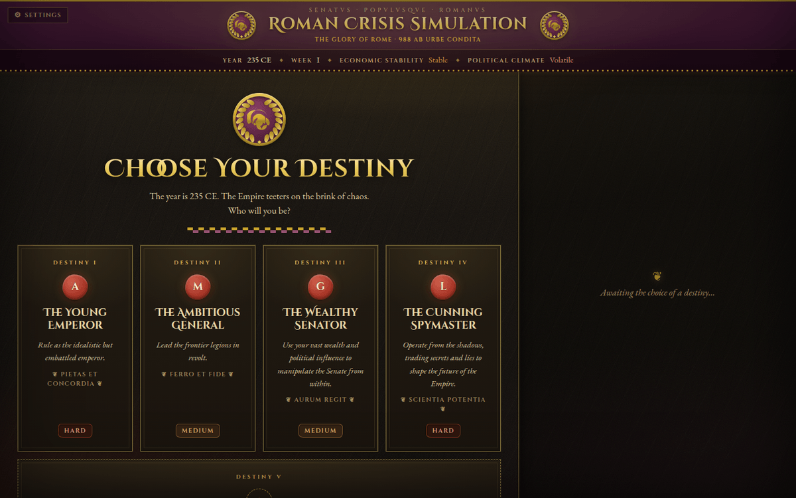
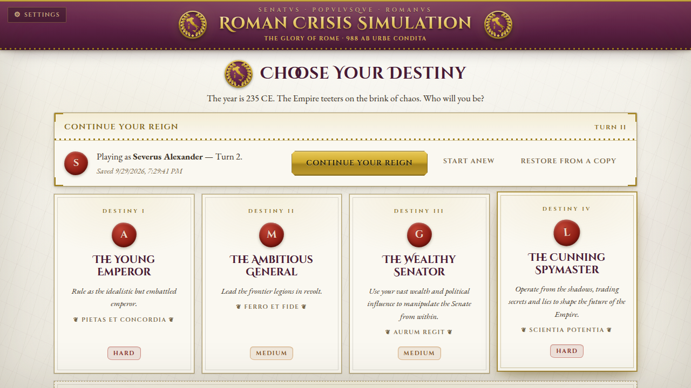
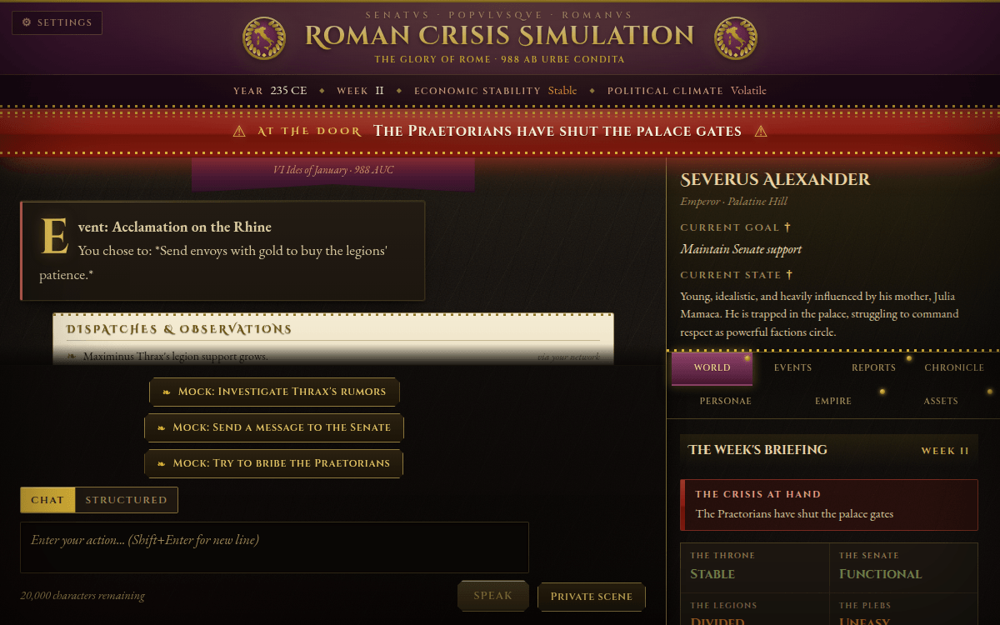
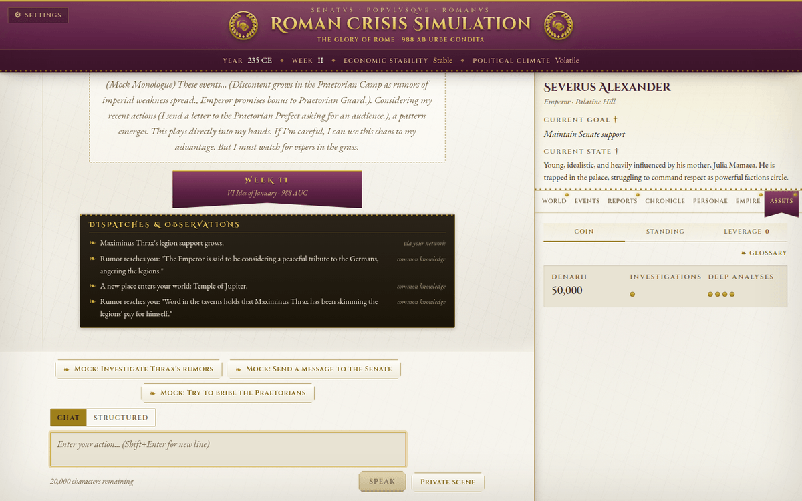
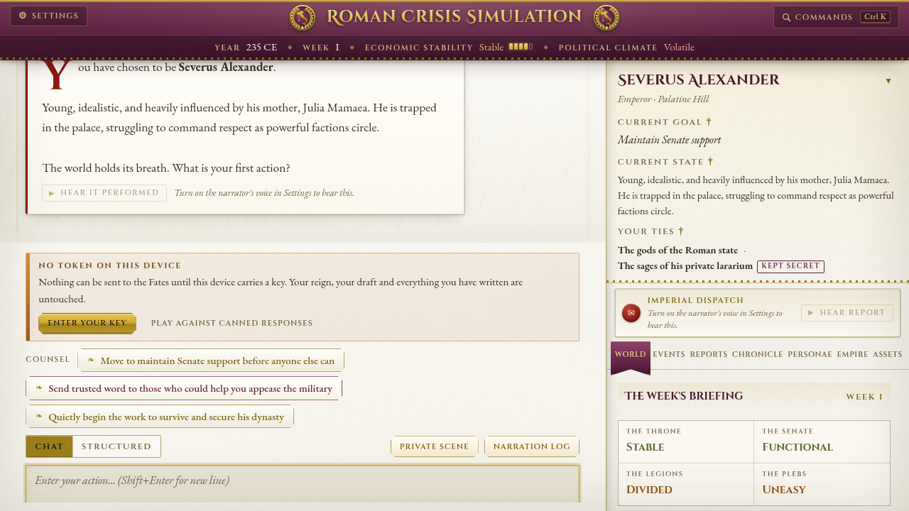
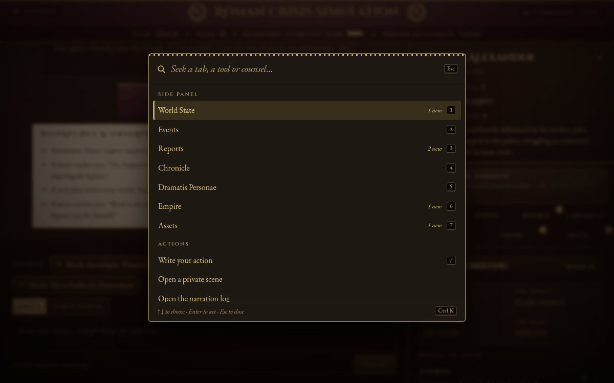
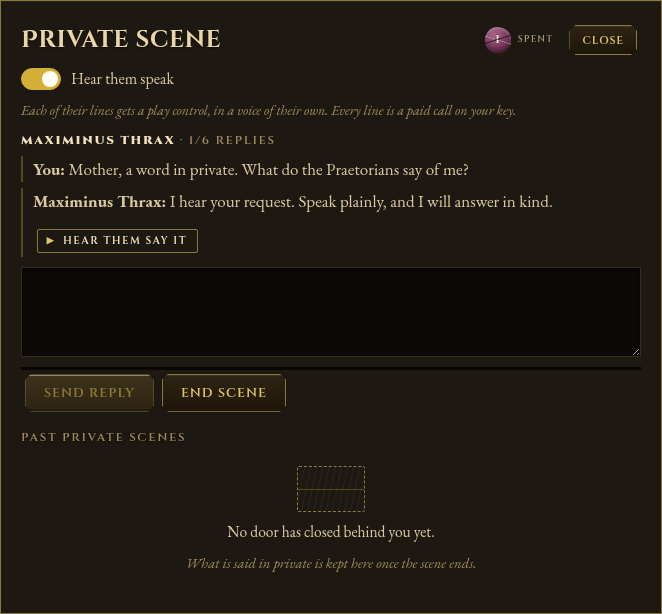
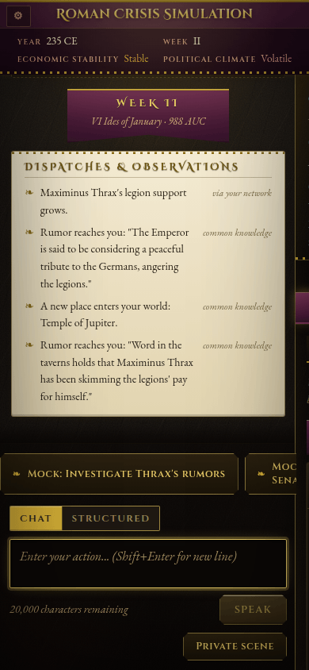

# Realmweaver: The Glory of Rome — Interface Wireframes & Visual Gallery

> **Status (October 2026 — Post-Uplevel Parts 1–10):** Originally written in July 2026 as structural wireframes for the visual redesign, this document now pairs the structural schematics with **production screenshots of the shipped `LVX` and `NOX Romae` interfaces** and updates every screen inventory to match the October 2026 codebase.

---

## Current Shipped State (October 2026 — Visual Gallery)

| **S1 — Choose / Forge Your Destiny (`NOX Romae`)** | **S1 — Compact Hero & Destiny Forge (`LVX`)** |
| :---: | :---: |
|  |  |
| **S2 — Main Game View & Crisis Banner (`NOX Romae`)** | **S2 — Main Game View & Intelligence Desk (`LVX`)** |
|  |  |
| **S2b — Dramatis Personae, Marks, Ties & Voice Row** | **Overlays — `Ctrl+K` Command Palette & Gold Coin Badges** |
|  |  |
| **Overlays — 1-on-1 Private Audience & Direct Voice** | **Mobile (`< 768px`) — Swipeable Diptych Leaves** |
|  |  |

---

**Purpose:** A complete structural and behavioral description of every interface in the game — wireframes, element inventories, data sources, and states — alongside companion design notes in `UI_SYSTEMS_CURRENT_AND_FUTURE.md`.

All file references are relative to `roman_crisis_simulation/src/`.

---

## 0. Screen Map

There is no router. One shell renders everything; the `GameState` enum (`types.ts:3-8`) and two
flags decide what is visible.

```
                    ┌─────────────────────────────┐
                    │  APP SHELL (always mounted) │
                    │  Header + CrisisBanner      │
                    │  + 2-pane body              │
                    └──────────────┬──────────────┘
              GameState == SETUP   │   GameState != SETUP
           ┌───────────────────────┴───────────────────────┐
           ▼                                               ▼
 ┌───────────────────────┐                   ┌───────────────────────────┐
 │ S1 CHARACTER SELECT   │                   │ S2 MAIN GAME VIEW         │
 │  (full-width hero     │                   │  • Chronicle + Composer   │
 │   + Forge Destiny)    │                   │  • 7-Tab Intel Desk       │
 └───────────────────────┘                   └─────────────┬─────────────┘
                                                           │ focus-trapped overlays (role="dialog")
                                       ┌───────────────────┼──────────────────┐
                                       ▼                   ▼                  ▼
                             ┌──────────────────┐ ┌────────────────┐ ┌───────────────┐
                             │ S3 GM LEDGER     │ │ S4 EVENT MODAL │ │ S5 ERROR /    │
                             │ (11 tabs +       │ │ (activeEvent   │ │ S6 EPILOGUE   │
                             │  turn rail)      │ │  != null)      │ │ + Cmd/Settings│
                             └──────────────────┘ └────────────────┘ └───────────────┘
```

Input-enablement per state: `AWAITING_PLAYER_INPUT` (composer live; pills/retry may show),
`PROCESSING` (composer locked, staged `TypingIndicator` and streaming narration visible),
`AWAITING_EVENT_CHOICE` (S4 blocks the screen until a choice is made), and `GAME_OVER`
(replaces S2 with `EpilogueScreen`).

---

## S0. App Shell (persistent chrome)

Files: `App.tsx`, `components/Header.tsx`, `components/CrisisBanner.tsx`, `design/shell.css`

```
┌────────────────────────────────────────────────────────────────────────────┐
│ [Medallion]  THE GLORY OF ROME   Year 235 · Wk XIV · Econ ●●●○○ · Politics │
│                                        [Commands ⌘K] [LVX/NOX] [⚙ Settings]│
├────────────────────────────────────────────────────────────────────────────┤
│ ⚠  ONGOING CRISIS   Succession dispute grips the capital                ⚠ │
├──────────────────────────────────────────────┬─────────────────────────────┤
│                                              │                             │
│         CHRONICLE PANE (2/3 desktop)         │  INTELLIGENCE DESK (1/3)    │
│         (Leaf 1 < 768px, swipeable)          │  (Leaf 2 < 768px, swipeable)│
│         [see S2a]                            │  [see S2b]                  │
│                                              │                             │
└──────────────────────────────────────────────┴─────────────────────────────┘
```

**Element inventory**
| Element | Data | Behavior |
|---|---|---|
| Italia Medallion + Game Title | static (`docs/ui-refresh/11-logo-closeup.png`) | decorative emblem + *Cinzel Decorative* masthead |
| Year / Week | `worldState.year`, `.week` | advances each turn; week rolls over to a new year at 52 |
| Economic Stability / Political Climate | `worldState.economic_stability`, `.political_climate` | updated by `'world'` deltas (`ai/core/engine.ts`); Economic Stability renders a 5-pip grade meter (`events/stabilityVocabulary.ts`) and a "changed this week" mark |
| Commands (`Ctrl+K` / `?`) | `hooks/useCommandPalette.ts` | opens `CommandPalette.tsx` (jumps to any of the 7 registers with unseen counts, composer, Private Audience, Narration Log, Settings, or GM Ledger) |
| Lighting switch (`LVX` / `NOX`) | `persistence/uiPrefs.ts` | switches between **LVX** (warm stone/papyrus) and **NOX Romae** (`design/nocturne.css` obsidian/torchlight) |
| `⚙ Settings` button | `components/SettingsMenu.tsx` | opens consolidated configuration modal (Gemini API key `D34`, Pacing `D23`, Reading register, Narration Voice & Cast, Workshop toggles for Mock Mode & GM Console) |
| Crisis banner | `simulationState.major_ongoing_crisis` | renders when non-null; full-width, `role="alert"` |
| Keyless Mock Banner | `persistence/apiKey.ts` | when no API key is set and Mock Mode is off, offers one-click *"Play against canned responses"* |

**Responsive layout:** During `SETUP`, `CharacterSelection` spans full width (`docs/ui-refresh/18-destiny-full-width.png`). During active play on desktop (`>= 768px`), the Chronicle (2/3) and Intelligence Desk (1/3) sit side-by-side. Below `768px` (`design/shell.css` Section VIII), the two panes become horizontally swipeable scroll-snap leaves and the masthead compacts into a 2×2 stat grid.

---

## S1. Character Selection

File: `components/CharacterSelection.tsx`. Spans full width during `SETUP` (`docs/ui-refresh/04-after-desktop-select-nox.png`, `docs/ui-refresh/19-destiny-compact-hero.png`).

### S1a — Default (shown with an existing save)

```
┌──────────────────────────────────────────────────────────────┐
│                     CHOOSE YOUR DESTINY                      │  ← page title
│    The year is 235 CE. The Empire teeters… Who will you be?  │  ← subtitle
│ ┌──────────────────────────────────────────────────────────┐ │
│ │  CONTINUE YOUR REIGN                    ┌──────────────┐ │ │  ← save card (only if
│ │  Playing as Maximinus Thrax — Turn 12   │ [Continue]   │ │ │    autosave exists);
│ │  Saved 7/18/2026, 3:41 PM               │  Start anew  │ │ │    amber-highlighted
│ │                                         └──────────────┘ │ │
│ └──────────────────────────────────────────────────────────┘ │
│ ┌───────────────────────────┐  ┌───────────────────────────┐ │
│ │ THE YOUNG EMPEROR         │  │ THE AMBITIOUS GENERAL     │ │  ← 2-column grid of
│ │ Difficulty: Hard          │  │ Difficulty: Medium        │ │    preset character
│ │ Rule as the idealistic…   │  │ Lead the frontier…        │ │    cards (text only,
│ │ [        Select         ] │  │ [        Select         ] │ │    no portraits)
│ └───────────────────────────┘  └───────────────────────────┘ │
│ ┌───────────────────────────┐  ┌───────────────────────────┐ │
│ │ THE WEALTHY SENATOR       │  │ THE CUNNING SPYMASTER     │ │
│ │ …                         │  │ …                         │ │
│ └───────────────────────────┘  └───────────────────────────┘ │
│ ┌───────────────────────────┐                                │
│ │ CREATE YOUR OWN           │   ← 5th card, opens S1b        │
│ │ [    Self-Describe      ] │                                │
│ └───────────────────────────┘                                │
└──────────────────────────────────────────────────────────────┘
```

### S1b — Custom creation form (replaces the grid)

```
┌──────────────────────────────────────────────────────────────┐
│                    FORGE A NEW DESTINY                       │
│ ┌──────────────────────────────────────────────────────────┐ │
│ │ Use default 235 CE scenario [checkbox] Custom gamestate  │ │  ← world-mode switch: one
│ └──────────────────────────────────────────────────────────┘ │    checkbox between two labels
│  META-NARRATIVE                    (only when custom = on)   │
│  helper copy: "Describe the core theme of your story…"       │
│  ┌────────────────────────────────────────────────────────┐  │
│  │ [textarea, ~3 rows, placeholder example]               │  │
│  └────────────────────────────────────────────────────────┘  │
│  YOUR PERSONA                                                │
│  helper copy: name, position, core motivations…              │
│  ┌────────────────────────────────────────────────────────┐  │
│  │ [textarea, ~6 rows, placeholder example]               │  │
│  └────────────────────────────────────────────────────────┘  │
│  (inline error text, red, on validation failure)             │
│  ← Back to suggestions            [Create Character]         │  ← button label becomes
└──────────────────────────────────────────────────────────────┘    "Generate World" if custom
```

### S1c — Loading

Full-pane centered text: **"Consulting the Fates…"** / "Your destiny is being written."
No progress bar or stage indication, though world generation takes many seconds and can fail
(failure returns to S1b with an inline error line).

**Element inventory & behavior**
| Element | Behavior |
|---|---|
| Save card | Continue → restores the full autosave and enters the game; "Start anew" link → native `window.confirm()` dialog, then deletes the save |
| Preset card ×4 | name, difficulty label (Hard/Medium), one-line pitch, Select button → starts the game immediately with that character |
| Create-your-own card | switches the pane to S1b |
| Scenario toggle | checkbox choosing between default 235 CE scenario and AI-generated custom world; toggling reveals/hides the meta-narrative field |
| Textareas | required-field validation with inline error string; entered text survives Back |
| Back link | returns to S1a |

---

## S2. Main Game View

### S2a — Chronicle & Composer Pane (left 2/3 on desktop, Leaf 1 `< 768px`)

Files: `App.tsx`, `components/Chat.tsx`, `components/DispatchesDigest.tsx`, `components/StructuredComposer.tsx`

```
┌──────────────────────────────────────────────────────────────┐
│  ────────  WEEK XIV · THE CHRONICLER SETS DOWN THE DAY ───── │  ← TurnRibbon (sender: 'ribbon')
│  ┌────────────────────────────────────────────┐              │
│  │ GM narration bubble (streamed or instant)  │              │  ← stone/obsidian card, crimson
│  │ safe React inline formatting (no innerHTML)│              │    left edge, literary Garamond
│  │ [ ▸ Hear it performed ]                    │              │  ← NarrationVoiceControl (TTS)
│  └────────────────────────────────────────────┘              │
│  ┌────────────────────────────────────────────┐              │
│  │ DISPATCHES DIGEST (perception-filtered)    │              │  ← DispatchesDigest.tsx
│  │ • Denarii −20,000 · The Suburra → Unrest   │              │    (only player-visible deltas)
│  └────────────────────────────────────────────┘              │
│                 ┌───────────────────────────────────────┐    │
│                 │ Player decree / action bubble         │    │  ← right-aligned crimson card
│                 └───────────────────────────────────────┘    │
│              ────────  INNER THOUGHTS  ────────              │
│  ┊ centered card, dashed border, italic monologue          ┊  │  ← sender: 'player_monologue'
│              ──────────────────────────────────              │
│  ┌──────────────────────────┐                                │
│  │ ● ● ●  Rivals move in    │   ← TypingIndicator driven by  │
│  │        the dark…         │     live TurnStage callbacks   │
│  └──────────────────────────┘                                │
│ ─────────────────────────────────────────────────────────────│  ← Composer Dock
│   ( Suggested action ) ( Suggested action ) ( Suggested )    │  ← ActionPills (counsel)
│  ┌───────────────────────────────────────────┐ ┌──────────┐  │
│  │ Enter your decree… (or open Tablet ▾)     │ │  SEND    │  │  ← ChatInput + StructuredComposer
│  └───────────────────────────────────────────┘ └──────────┘  │    (Order + Private Intent +
│  [ Private Audience ]  [ Narration Log ]       [ GM LOG ]*   │     Inquiries)
└──────────────────────────────────────────────────────────────┘
```

**Message stream**
- Four visually distinct stream voices:
  1. **GM narration** (`sender: 'gm'`): left-aligned stone/obsidian card with crimson border, safe React-rendered formatting (no `dangerouslySetInnerHTML`), and a **"Hear it performed"** button (`NarrationVoiceControl`, `narration/`).
  2. **Player action** (`sender: 'player'`): right-aligned imperial-crimson bubble.
  3. **Inner monologue** (`sender: 'player_monologue'`): centered dashed-border card with italic prose.
  4. **Week-advance ribbon** (`sender: 'ribbon'`): decorative **`TurnRibbon`** divider (`components/ui/Brand.tsx`).
- **Dispatches Digest (`components/DispatchesDigest.tsx`):** compact perception-filtered summary of what visibly changed this week (`buildPlayerPerceivedDigest` in `perception/visibility.ts`).
- **Staged Progress & Streaming (`6.1` / `6.2`):** `TypingIndicator` reflects real-time `TurnStage` callbacks from `ai/core/turn.ts`, and `StreamingNarrationBubble` streams narration token-by-token (unless set to Instant in `ReadingSettings.tsx`).
- **Smart Scroll Follow (`hooks/useChatFollow.ts`):** follows streaming text when at the bottom, or surfaces a *"Back to the latest"* pill when the reader has scrolled up (`docs/ui-refresh/16-to-the-latest-lvx.png`).

**Composer dock**
| Element | Behavior |
|---|---|
| `ChatInput` & `StructuredComposer` | Free-text decree textarea plus an expandable **Structured Tablet** (`playerInput/composerState.ts`, `turnSubmission.ts`) separating **Primary Order**, **Private Intent**, and **Inquiries** (`docs/ui-refresh/18-structured-desk-1280x720.png`) |
| `ActionPills` | AI-suggested counsel actions (plus 3 zero-call starter pills on Turn 1 via `deriveStarterActions`); clicking fills the composer |
| `Private Audience` | Opens `PrivateSceneSheet.tsx` (`D39`) for a 1-on-1 multi-exchange conversation with a known NPC in your location |
| `Narration Log` | Opens `NarrationLogSheet.tsx` (`narration/narrationLog.ts`) to inspect or replay acted scripts and `<performance cues>` |
| Retry button | Appears after a transient `AiServiceError`; re-runs the failed turn submission and restores the draft |
| `GM LOG` button | Opens S3 (`GameMasterScreen`); hidden by default until unlocked via `Ctrl+Shift+G` or **⚙ Settings → Workshop** |

---

### S2b — Intelligence Desk / Side Panel (right 1/3 on desktop, Leaf 2 `< 768px`)

Files: `components/SidePanel.tsx`, `components/PlayerStatus.tsx`, `components/tabs/*`

```
┌───────────────────────────────────────────┐
│ MAXIMINUS THRAX                    [Fold] │  ← PlayerStatus card (foldable via
│ Commander of Legio XXII                   │    readingPrefs; shows Goal, State,
│ Marks: Battle-Scarred · Ties: Legions     │    Outward Marks D48 & Open Ties D49)
├───────────────────────────────────────────┤
│ IMPERIAL DISPATCH          [Hear Report]  │  ← High English TTS reading of all
│ High English tab report                   │    7 intelligence registers
├───────────────────────────────────────────┤
│ WORLD ②│EVENTS ①│REPORTS ③│CHRONICLE      │  ← 7 ARIA tabs (role="tablist",
│ PERSONAE│EMPIRE│ASSETS                    │    roving arrows, 1–7 keys) with
├───────────────────────────────────────────┤    GOLD COIN CHANGE-COUNT BADGES
│                                           │
│  [active register content, scrolls]       │
│                                           │
└───────────────────────────────────────────┘
```

- **Gold Coin Change-Count Badges (`tabChangeCountsFor`):** Replaced the old pulsing dot. Whenever a committed turn produces player-perceivable changes (`perception/visibility.ts`), each affected register displays a **gold coin badge with the exact unseen change count** (`①`, `②`, …) until the player views that register (`hooks/useSeenRegisters.ts`, `docs/ui-refresh/16-tab-counts.png`).
- **Imperial Dispatch (`hooks/useImperialDispatch.ts`):** Synthesizes and voices a spoken situation briefing across the intelligence registers on demand.
- **Keyboard & ARIA Contract:** `role="tablist"`/`role="tab"`/`aria-selected`/`aria-controls` with roving arrow-key navigation (`components/ui/rovingRadio.ts`) and direct `1`–`7` single-key shortcuts.

#### Tab 0 — WORLD (`tabs/WorldStateTab.tsx`, 204 lines)
```
│ The State of the Empire                   │
│ ┌───────────────────────────────────────┐ │
│ │ The Throne                  [Stable]  │ │  ← 5 macro SimulationState standings
│ │ The Senate               [Fractured]  │ │    with severity badges and fallen-
│ │ The Legions                [Restive]  │ │    standing warnings (fellStandings)
│ │ The Plebs                  [Content]  │ │
│ │ Ongoing Crisis       [Succession...]  │ │
│ └───────────────────────────────────────┘ │
│ Recent Headlines & Briefing Pointers      │
│ Your Intelligence Picture (by Region)     │  ← filtered by isRegionKnownToPlayer;
│  [known region cards] / ["Beyond sight"]  │    unmonitored regions masked
```

#### Tab 1 — EVENTS (`tabs/CurrentEventsTab.tsx`, 256 lines)
- Lists this week's public headlines and occurrence inquiries (`occurrenceFindings` in `knowledge/store.ts`).
- Clicking a headline triggers an in-world intelligence inquiry (`getClarificationOnEvent`) whose findings commit to the persistent knowledge store.

#### Tab 2 — REPORTS (`tabs/ReportsTab.tsx`, 229 lines)
```
│ [ By Source (4)  |  By Topic (3) ]        │  ← SubRail register switcher
│ ───────────────────────────────────────── │
│ YOUR INFORMANT NETWORK        as of Wk XI │
│  "Pontius is moving silver to Antioch."   │
│  An uncorroborated claim; plausible...    │  ← prose certaintyClause (D25/D26:
│  Corroborated by 1 other report           │    NO numeric % badge ever shown)
```
- **No Numeric Credibility Percentages (`D25`, `D26`):** `CredibilityBadge` percentages were removed. Reports group by **Source** or **Topic** (`SubRail`) and frame reliability strictly in-world via source voice (`knowledgeSourceLead`), corroboration counts (`corroboration`), and prose certainty clauses (`certaintyClause`).

#### Tab 3 — CHRONICLE (`tabs/ChronicleTab.tsx`, 109 lines)
```
│ [ The Reign (14)  |  The Fates (3) ]      │  ← SubRail register switcher
│ ───────────────────────────────────────── │
│  ●  Turn XIV · Crisis                     │  ← Continuous vertical Reign Spine
│  │  The Rhine Legions Refuse the Donative │    (buildChronicleSpine)
│  │  Your order: "Arrest the tribunes..."  │
│  ◌  Turns VIII–XIII (6 quiet weeks)       │  ← Quiet stretches collapse into
│  │  [ Unroll them ]                       │    an expandable summary row
│  ◆  Turn VII · Fate                       │
│     THE PRAETORIAN DEMAND                 │
```
- **Shipped Reign Spine (`buildChronicleSpine`):** Default sub-register **The Reign** renders every week from `turnHistory` along a continuous vertical spine with collapsible quiet stretches. **The Fates** sub-register preserves the reverse-chronological log of scripted-event choices (`eventHistory`).

#### Tab 4 — DRAMATIS PERSONAE & RELATIONSHIPS (`tabs/DramatisPersonaeTab.tsx`, 247 lines + `tabs/RelationshipsTab.tsx`, 135 lines)
```
│ [ Dossiers (6)  |  Relationships (4) ]    │  ← SubRail switches between Dossiers
│ ───────────────────────────────────────── │    and the Sourced Relationship Web
│ ▌PRAETORIAN GUARD                         │
│ ┌───────────────────────────────────────┐ │
│ │ Marcus Aedinius Julianus              │ │  ← Only entities known to player
│ │ Praetorian Prefect   [Collapse] [❧]   │ │    (isEntityKnownToPlayer); [❧]
│ │ Status: Alive (as perceived)          │ │    toggles inline Glossary marginalia
│ │ Voice: Fenrir · clipped camp Latin [▸]│ │  ← PersonaVoiceRow (voiceCast.ts)
│ │ Outward Marks: Limping (since Wk IV)  │ │  ← Perceived conditions only (D48)
│ │ Ties: Praetorian Guard · Cult (Known) │ │  ← Open + learned secret ties (D49)
│ │ Signs Seen: "His hand shook..." (Wk X)│ │  ← Composure tells witnessed (D50)
│ │ Sourced Observations:                 │ │  ← RelationshipObservations.tsx
│ │  • Wk IX (Informant): "Met Thrax..."  │ │    (no numeric trust bar / axes!)
│ │ Persistent Dossier (D14 / D27):       │ │
│ │  • Assessment (Held since Wk VI)      │ │  ← Persisted in knowledge/store.ts
│ │  • Beliefs (Held · Stale > 4 wks)     │ │    across tab switches & saves!
│ │  • Scheme Clues (2 / 3 clues gathered)│ │  ← Progressive clue threshold
│ │  • Secrets [ Gather Intel (1 Inv.) ]  │ │
│ └───────────────────────────────────────┘ │
```
- **Sub-Register 1 — Dossiers (`DramatisPersonaeTab.tsx` + `dramatisPersonaeUi.tsx`):**
  - Omniscient numeric trust bars, 5-axis numbers, and free "Raw Thoughts" probes are **gone** (`D13`, `D25`, `D36`).
  - Displays **Outward Marks** (`perceivedConditionsOf`, `D48`), **Open & Secret Ties** (`publicAffiliationsOf` + `knownAffiliationsOf`, `D49`), **Composure Signs Seen** (`signsSeenOf`, `D50`), and the character's **AI Cast Voice Row** (`PersonaVoiceRow.tsx`).
  - Uncovered *Beliefs*, *Scheme Clues*, *Secrets*, and *Deep Analyses* are stored durably in `knowledge/store.ts` (`deriveDossier`, `D14`) with staleness indicators (`DOSSIER_COLD_THRESHOLD`, `D27`).
- **Sub-Register 2 — Relationships (`components/tabs/RelationshipsTab.tsx`, 135 lines):**
  - Renders the player's **Sourced Relationship Web** (`D13`, `D42`): unordered pairs of characters (`Marcus — Maximinus Thrax`) listing every witnessed or reported bond, direct quote, source attribution, prose certainty clause, and turn age. Never reads ground-truth `entity.relationships`.

#### Tab 5 — EMPIRE (`tabs/EmpireTab.tsx`, 166 lines)
- Cards for each region in `worldState.regions`, gated by `isRegionKnownToPlayer` (`perception/visibility.ts`). Known regions show stability badge, controlling faction, local events, and present characters; unmonitored regions show *"Beyond your sight"*.

#### Tab 6 — ASSETS (`tabs/ResourcesTab.tsx`, 189 lines)
- Splits `playerEntity.resources` into **Direct Assets** (with `CoinPips` visual counters) and **Influence & Support**, plus quoted blackmail holdings (`blackmail_on_*`).

---

## S3. The Fates' Ledger — Game Master Screen (`components/GameMasterScreen.tsx`, 351 lines)

Files: `components/GameMasterScreen.tsx`, `components/gm/*`

Full-screen dark-tablinum modal (`Ctrl+Shift+G`), equipped with `createFocusTrap` (`components/ui/focusTrap.ts`), `Escape`-to-close, and roving arrow-key navigation (`radioGroupKeyDown`).

```
┌────────────────────────────────────────────────────────────────────────────┐
│ THE FATES' LEDGER (GAME MASTER TOOLS)         [Export Eval Corpus]    [✕]  │
│ ┌────────────────────────────────────────────────────────────────────────┐ │
│ │ GM INTERVENTION (gated by D32 gmInterventionEnabled)                   │ │
│ │ [textarea: inject directive into next turn's adjudication]  [Save]     │ │
│ └────────────────────────────────────────────────────────────────────────┘ │
│ Turn Selector Rail: [ Turn XIV (Latest) ▾ ]  Reign Seed: 0x8F4A...         │
│ ────────────────────────────────────────────────────────────────────────── │
│ SUMMARY │ WHAT CHANGED │ NARRATION │ ACTIONS │ PRIVATE │ GROUND TRUTH │    │
│ NPC PERCEPTION │ RAW JSON │ FIXTURES │ TRUTH LEDGER │ PLAYER KNOWLEDGE     │
│ ┌────────────────────────────────────────────────────────────────────────┐ │
│ │ [Active Tab Inspector for Selected Turn (or Campaign-Wide Collection)] │ │
│ │  e.g. Ground Truth vs. Player Perceived + [Strike the mould again]     │ │
│ └────────────────────────────────────────────────────────────────────────┘ │
└────────────────────────────────────────────────────────────────────────────┘
```

**The 11 Specialized GM Inspector Tabs (`TABS` in `GameMasterScreen.tsx`):**

| # | Tab | Component | What It Inspects |
|---|---|---|---|
| 1 | `summary` | `SummaryView.tsx` | Player submission, generated narration, and `LatencyStrip` per pipeline stage |
| 2 | `what changed` | `WhatChangedView.tsx` | Unified post-turn delta diff and full entity state snapshot for the selected turn |
| 3 | `narration` | `NarrationView.tsx` | Schema-declared attribution audit and redaction inspection (`D42`) |
| 4 | `actions` | `ActionsView.tsx` | AI Director spotlight selection, persistent `npcIntents`, and each NPC mind's private reasoning |
| 5 | `private` | `PrivateView.tsx` | GM-private notes, raw `PrivateSceneGmView` records (`D39`), and pending intelligence fallout |
| 6 | `ground truth` | `GroundTruthView.tsx` | Side-by-side raw ground truth vs. `perception/visibility.ts` player view, hidden d20 & composure rolls, and one-click deterministic seed replay (*"Strike the mould again"*, `D51`) |
| 7 | `npc perception` | `NpcPerceptionView.tsx` | Exact bounded world slice (`perception/npcPerception.ts`, `D10`) each spotlight NPC saw |
| 8 | `raw json` | `RawView.tsx` | Captured `RawCallRecord`s (model, latency, attempts, validation, prompt/response) + adjudication JSON |
| 9 | `fixtures` | `FixturesView.tsx` | Exportable test/eval fixtures from live turns |
| 10 | `truth ledger` | `TruthLedgerView.tsx` | Campaign-wide `D11` Truth Ledger (ground truth vs. what reports claimed) |
| 11 | `player knowledge` | `PlayerKnowledgeView.tsx` | Campaign-wide `D21` player belief graph (`knowledge/store.ts`) |

---

## S4. Event Modal (`components/EventModal.tsx`)

Blocking modal (`role="dialog"`, `aria-modal="true"`, focus-trapped via `createFocusTrap`) for scripted fate events (`events/engine.ts`). Mandatory choice — no Escape/close until an option is selected; logs the choice to `ChronicleTab` (`The Fates` register).

---

## S5. Error Boundary (`components/ErrorBoundary.tsx`) & S6. Epilogue Screen (`components/EpilogueScreen.tsx`)

- **S5 (`ErrorBoundary.tsx`):** Full-screen render-crash recovery ("The Republic Endures") with **Restore Last Save** / Reload.
- **S6 (`EpilogueScreen.tsx`):** Rendered when `GameState === GAME_OVER` (player death). Displays an AI-generated Tacitus-style obituary stele (with a deterministic fallback epitaph in Mock Mode or offline), reign statistics, inferred ambition, and a **Begin a New Reign** button.

---

## 6. Primitive Inventory (October 2026)

| Primitive | Implementation | Behavior & Accessibility |
|---|---|---|
| Card & Panel surfaces | `components/ui/Core.tsx` (`Card`), `design/components.css` | Tokenized `LVX` stone/papyrus and `NOX Romae` obsidian surfaces |
| Buttons & ActionPills | `components/ui/Core.tsx` (`Button`), `components/ui/Game.tsx` (`ActionPill`) | Shared variants, reduced-motion aware, high-contrast focus rings |
| Tab bars & SubRails | `SidePanel.tsx` (7 tabs), `GameMasterScreen.tsx` (11 tabs), `components/ui/SubRail.tsx` | Full `role="tablist"`/`role="tab"`/`aria-selected`/`aria-controls` + roving arrow-key navigation (`rovingRadio.ts`); `SidePanel` tabs carry **gold coin change-count badges** (`tabChangeCountsFor`) |
| Accessible Dialogs | `GameMasterScreen`, `EventModal`, `SettingsMenu`, `CommandPalette`, `PrivateSceneSheet`, `NarrationLogSheet` | `role="dialog"`, `aria-modal="true"`, `createFocusTrap` (`components/ui/focusTrap.ts`), and `Escape`-to-close (except mandatory `EventModal`) |
| Marks, Ties & Signs | `components/ui/Marks.tsx` (`MarkList`, `TieList`, `SignList`) | Displays perceived outward marks (`D48`), open/learned secret ties (`D49`), and witnessed composure tells (`D50`) |
| Economic & Coin Meters | `Header.tsx` (5-pip grade meter), `dramatisPersonaeUi.tsx` (`CoinPips`) | Non-color redundant pip meters (`events/stabilityVocabulary.ts`) |
| Inline Glossary Marginalia | `DramatisPersonaeTab.tsx` (`❧ Glossary`), `GlossaryTooltip.tsx` | Keyboard-accessible inline marginalia disclosures + tooltips |
| Stage & Streaming Progress | `TypingIndicator`, `StreamingNarrationBubble` | Driven by `TurnStage` pipeline callbacks and streaming chunks |
| Empty Register Silhouettes | `components/tabs/EmptyRegister.tsx` | Bespoke SVG silhouettes + actionable hints per register |

---

## 7. Core Architectural Invariants Reflected in the UI

1. **The Chronicle + Structured Composer is the primary turn surface.** Players can write free-form decrees or expand the **Structured Tablet** (`Order` + `Private Intent` + `Inquiries`), hold 1-on-1 **Private Audiences** (`D39`), and listen to acted TTS performances (`narration/`).
2. **Four stream voices (`gm`, `player`, `player_monologue`, `ribbon`)** plus the perception-filtered **Dispatches Digest** (`DispatchesDigest.tsx`) structure every week in the Chronicle.
3. **Information asymmetry is strictly enforced in code (`D5`, `D11`, `D13`, `D25`, `D26`):** No player-facing component ever reads hidden ground truth, numeric relationship axes, or numeric credibility percentages. The player's 7 registers render strictly from `perception/visibility.ts` and `knowledge/store.ts`.
4. **The Fates' Ledger (`Ctrl+Shift+G`) is the single omniscient surface (`D7`):** Its 11 tabs expose ground truth vs. player belief, bounded NPC perception, the Truth Ledger, seed replay verification (`D51`), and eval-corpus export.
5. **Responsive Desktop & Mobile Diptych:** Desktop (`>= 768px`) renders the 2/3 + 1/3 split; mobile (`< 768px`) renders two horizontally swipeable scroll-snap leaves (`design/shell.css`).
6. **WCAG AA Contrast, Keyboard Navigation & Motion Safety:** Pinned by `tests/colorContrast.test.ts`, `focusTrap.ts`, `rovingRadio.ts`, `CommandPalette.tsx` (`Ctrl+K`), and `ReadingSettings.tsx`.
