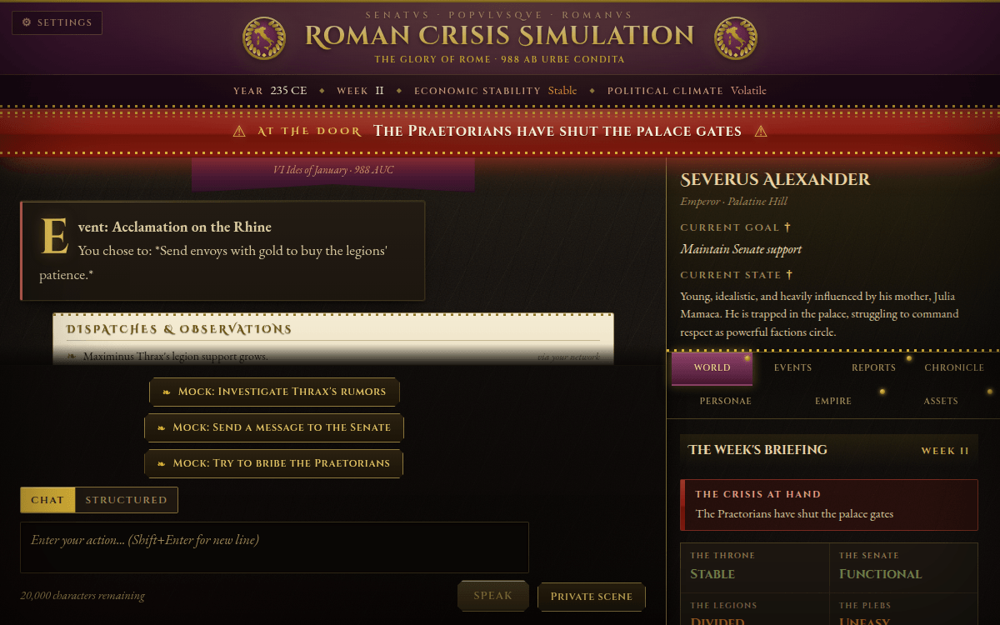
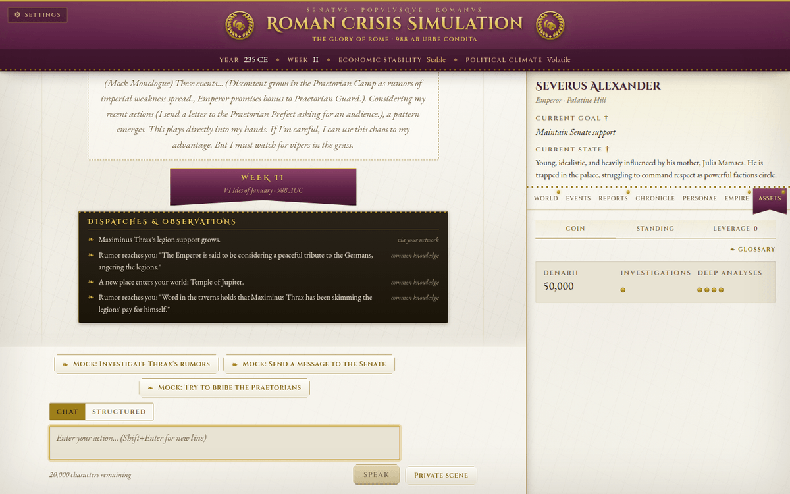
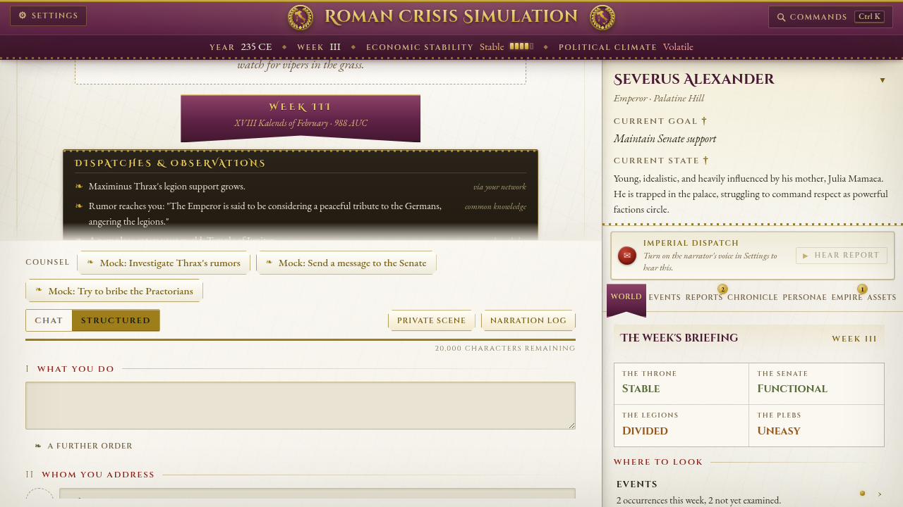
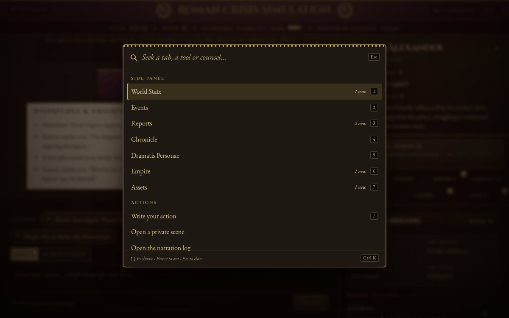
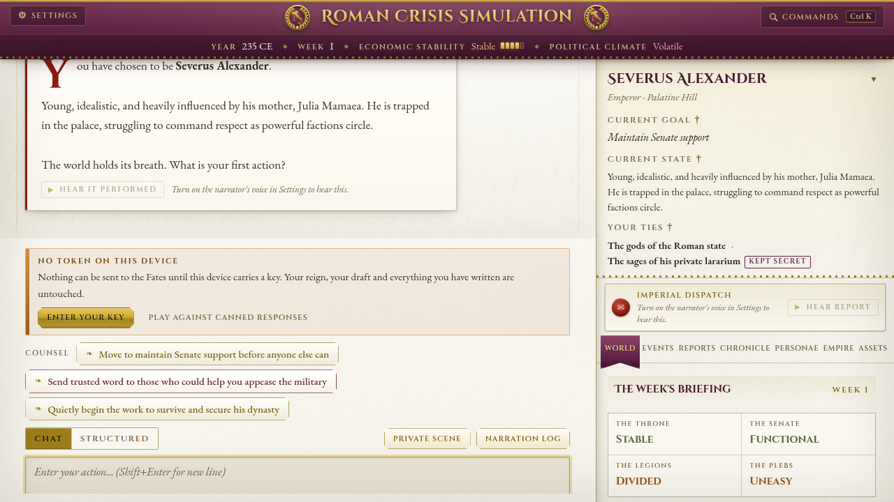
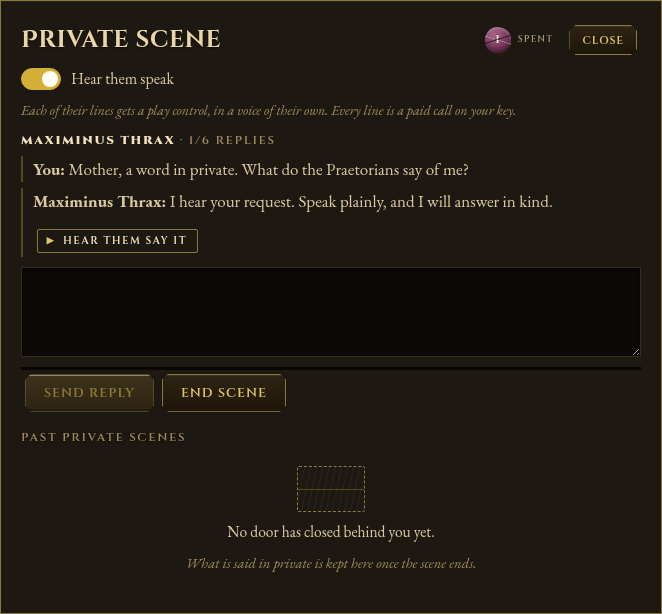

# Realmweaver: The Glory of Rome — UI Systems: Current State & Future Design

> **Status (October 2026 — Post-Uplevel Parts 1–10):** Originally drafted in July 2026 as a baseline audit and roadmap, almost every item proposed in Part II below has now **shipped into production** across Phases 2–6 and the September–October 2026 Uplevel (Parts 1–10). Start with the **Current Shipped State Overview** immediately below for today's architecture and visual showcase.

---

## Current Shipped State (October 2026 — Post-Uplevel Parts 1–10)

| **NOX Romae** — Torchlight Night Skin (`nocturne.css`) | **LVX** — Carrara Marble & Parchment Day Skin |
| :---: | :---: |
|  |  |
| **Structured Turn Composer & Folded Dossiers (`1280×720`)** | **`Ctrl+K` Command Palette & Gold Coin Change Badges** |
|  |  |
| **Persistent Dossiers, Marks, Ties & Keyless Mock Mode** | **AI Voice Cast & 1-on-1 Private Audience Voice** |
|  |  |

### Summary of What Has Shipped Since the Original Audit

- **100% Local Bundle & Self-Hosted Typography:** React 19, `@google/genai`, and `zod` are bundled locally by Vite (zero runtime CDN import maps), alongside self-hosted Latin subsets of *Cinzel*, *Cinzel Decorative*, and *EB Garamond*.
- **Dual Imperial Design System (`design/`):** Tokenized `gor-*` CSS architecture supporting **LVX** (warm stone & papyrus) and **NOX Romae** (obsidian marble & torchlight gold), pinned by automated WCAG AA contrast tests (`tests/colorContrast.test.ts`).
- **Reducer + Hooks Architecture (`state/` & `hooks/`):** All domain state lives in `state/gameReducer.ts` (`D17`), orchestrated by **23 focused hooks** in `hooks/` (`useExecuteTurn`, `usePlayerPerception`, `useNarrationVoice`, `useVoiceCast`, `useCommandPalette`, `usePrivateSceneController`, etc.).
- **7-Register Intelligence Desk with Gold Coin Badges:** `SidePanel.tsx` renders **World**, **Events**, **Reports**, **Chronicle**, **Personae**, **Empire**, and **Assets**, with perception-filtered **gold coin change-count badges** (`tabChangeCountsFor`), an **Imperial Dispatch** audio reader, and keyboard shortcuts (`1`–`7` and `Ctrl+K` / `?` Command Palette).
- **Information-Asymmetric Dossiers & Sourced Relationships (`D13`, `D14`, `D25`, `D36`, `D48`–`D50`):** Omniscient numeric trust bars and percentage credibility badges are gone. `DramatisPersonaeTab.tsx` and `RelationshipsTab.tsx` (`PERSONAE → RELATIONSHIPS`) render persistent dossiers from `knowledge/store.ts`, showing **Outward Marks** (`D48`), **Open & Secret Ties** (`D49`), **Composure Signs Seen** (`D50`), **Cast Voice Rows**, and sourced relationship edges with provenance and age.
- **Illuminated Reign Spine (`ChronicleTab.tsx`):** Rebuilt into a continuous vertical Reign Spine with two sub-registers (**The Reign** for weekly orders/headlines with collapsible quiet stretches, and **The Fates** for scripted event choices).
- **Theatrical Acted Narration & Bespoke Voice Cast (`narration/`):** Optional two-stage TTS pipeline (`gemini-3.8-flash` script prep with `<performance cues>` → `gemini-3.8-flash-tts`), AI Casting Director (`Settings → The Cast`), direct NPC voice in 1-on-1 **Private Audiences** (`PrivateSceneSheet.tsx`), and a replayable **Narration Log**.
- **The Fates' Ledger (`GameMasterScreen.tsx`):** Upgraded to an **11-tab** turn-scoped inspector (`summary`, `what changed`, `narration`, `actions`, `private`, `ground truth`, `npc perception`, `raw json`, `fixtures`, `truth ledger`, `player knowledge`) with a per-turn selector rail, one-click deterministic seed replay (*"Strike the mould again"*, `D51`), focus trap, `Escape` close, and roving arrow-key tab navigation.
- **Responsive Mobile Diptych (`< 768px`):** Horizontally swipeable scroll-snap leaves (**Chronicle ↔ Intelligence Desk**) with a compact 2×2 world-state masthead (`docs/ui-refresh/08-after-phone-game-nox.png`).

---

This document is the comprehensive reference for the user interface of the Roman Crisis Simulation.
It has two parts:

- **Part I — UI Systems Inventory**: an exhaustive inventory of every screen, component, and
  cross-cutting UI system, annotated with what shipped through October 2026.
- **Part II — UI Design Evolution Log**: the catalog of design proposals that drove Phases 2–6
  and the Uplevel, annotated with final implementation references.

All paths below are relative to `roman_crisis_simulation/src/` unless noted otherwise.

> **Companion document:** `UI_SCREEN_WIREFRAMES.md` describes each of these screens *visually* —
> structural wireframes, element inventories, and states.

---

# Part I — Current UI Systems

## 1. Architecture Overview

The UI is a **single-page React 19 application** with no router and no external UI framework.

| Concern | Current Implementation (October 2026) |
|---|---|
| Framework | React 19 (`react`, `react-dom`) bundled locally via Vite (`package.json`) |
| Build tool | Vite 6 (`vite.config.ts`), TypeScript ~5.8, Vitest 3 for unit/journey/eval suites |
| Styling | Tokenized `gor-*` Roman design system in `design/` (`tokens/*.css`, `components.css`, `shell.css`, plus `nocturne.css` for the **NOX Romae** night skin) |
| Fonts | Self-hosted Latin subsets (`design/tokens/fonts.css`): *Cinzel* (UI/labels), *Cinzel Decorative* (display headings), and *EB Garamond* (literary body/chronicle) |
| State management | Central domain reducer `state/gameReducer.ts` (`useReducer` + Context, `D17`) + **23 extracted hooks** in `hooks/`; `App.tsx` (744 lines) is a clean composition root |
| Routing | None — screens and overlays are switched by the `GameState` enum and modal controllers |
| AI client | Single `geminiService.ts` gateway (`@google/genai` + `zod` runtime validation); Bring-Your-Own-Key (`D34`) stored in browser `localStorage` |
| Persistence | Versioned `localStorage` autosave (`persistence/saveGame.ts` + `saveMigrations.ts`), cross-tab write detection (`crossTab.ts`), and JSON campaign export/import |

### 1.1 The UI State Machine

`GameState` (`types.ts:3-8`) is the master switch that determines what the player sees and
what input is allowed:

```
SETUP ──(character chosen)──► AWAITING_PLAYER_INPUT ──(send action)──► PROCESSING
   ▲                                   ▲                                    │
   │                                   │◄──(turn commit + no event)─────────┤
   └── (fresh load, no continue)       │                                    │
                                       └◄─(choice made)── AWAITING_EVENT_CHOICE ◄─(event triggered)
```

- `SETUP` — character selection screen occupies the chat pane; side panel shows a placeholder.
- `AWAITING_PLAYER_INPUT` — chat input enabled; action pills and retry button may render.
- `PROCESSING` — input disabled, `TypingIndicator` bubble animates, placeholder cycles themed copy,
  `beforeunload` guard is armed (`App.tsx:134-144`).
- `AWAITING_EVENT_CHOICE` — `EventModal` blocks the screen until a choice is made.

Notably absent: a `GAME_OVER` state (flagged in `ROADMAP_4_FUNNESS.md` P0.1 — a dead player can
keep taking turns). *(SHIPPED — `GameState.GAME_OVER` now exists in `types.ts`; a dead player's
turn routes there and renders `EpilogueScreen`, see 7.2)*

### 1.2 Layout

`App.tsx` + `design/shell.css` render a responsive diptych layout:

```
┌────────────────────────────────────────────────────────────────────────────┐
│ Header (Medallion, Title, Year/Week, 5-Pip Econ & Politics,                │
│         Commands [Ctrl+K], LVX/NOX Theme Switch, ⚙ Settings)               │
├────────────────────────────────────────────────────────────────────────────┤
│ CrisisBanner (when a major crisis is active) · Keyless Mock Notice         │
├───────────────────────────────────────────┬────────────────────────────────┤
│ Chronicle Pane (2/3 desktop, Leaf 1 <768) │ SidePanel (1/3 desktop, Leaf 2)│
│  • Full-width CharacterSelection (SETUP)  │  • Foldable PlayerStatus card  │
│  • Message stream + TurnRibbon + Voice    │  • Imperial Dispatch TTS bar   │
│  • DispatchesDigest (perception-filtered) │  • 7-tab intelligence desk     │
│  • ActionPills + StructuredComposer       │    with gold coin change counts│
│  • Private Audience / Narration Log bar   │                                │
└───────────────────────────────────────────┴────────────────────────────────┘
  Overlays: GameMasterScreen (11-tab modal) · EventModal · PrivateSceneSheet
            CommandPalette (Ctrl+K) · SettingsMenu · NarrationLogSheet
```

- **Desktop (`>= 768px`):** 2/3 Chronicle + 1/3 Intelligence Desk split; during `SETUP`, `CharacterSelection` spans full width (`docs/ui-refresh/18-destiny-full-width.png`).
- **Mobile (`< 768px`):** Horizontally swipeable scroll-snap leaves (**Chronicle ↔ Intelligence Desk**) with a compact 2×2 masthead (`design/shell.css` Section VIII, `docs/ui-refresh/08-after-phone-game-nox.png`).

---

## 2. Visual Design System

Implemented in `design/` (`tokens/{colors,typography,spacing,effects,fonts}.css`, `components.css`, `shell.css`, `styles.css`, and `nocturne.css`), replacing the pre-PR #4 inline CSS and Tailwind CDN:

- **Dual Themes (`LVX` & `NOX Romae`):**
  - **LVX (Day):** Warm Carrara stone, aged papyrus, sepia ink, imperial crimson (`--crimson-500`), gold (`--gold-500`), and Tyrian purple (`--tyrian-400`).
  - **NOX Romae (Night, `design/nocturne.css`):** Obsidian marble, torchlight ambers, and ivory typography.
- **Self-Hosted Latin Fonts (`design/tokens/fonts.css`):** *Cinzel Decorative* for display headings, *Cinzel* for Roman labels/registers, and *EB Garamond* for literary chronicle reading.
- **WCAG AA Contrast & Motion Safety:** Pinned by `tests/colorContrast.test.ts` across both themes; respects `prefers-reduced-motion` and the in-app **Motion: Still** setting (`ReadingSettings.tsx`).

---

## 3. Screen & Component Inventory

### 3.1 Header — `components/Header.tsx`
- Gilt **Italia medallion** (`docs/ui-refresh/11-logo-closeup.png`) and game title in *Cinzel Decorative*.
- Live world-state strip: **Year / Week / Economic Stability** (with a 5-pip grade meter from `events/stabilityVocabulary.ts` and "changed this week" indicator) / **Political Climate** (driven by `'world'` deltas in `ai/core/engine.ts`).
- Action controls: **Commands (`Ctrl+K`)**, **LVX / NOX** lighting toggle, and **⚙ Settings** (`components/SettingsMenu.tsx`, which houses the API key, pacing, reading preferences, narration voice & cast, and Workshop toggles including Mock Mode and GM Console).

### 3.2 CrisisBanner — `components/CrisisBanner.tsx`
- Full-width alert (`role="alert"`) rendered between Header and panes when
  `simulationState.major_ongoing_crisis` is non-null.
- Red gradient, amber warning glyphs, "ONGOING CRISIS" label — the first surfaced piece of the
  otherwise-hidden `SimulationState`.

### 3.3 CharacterSelection — `components/CharacterSelection.tsx`
The entire pre-game flow, rendered full-width during `SETUP`:
- **"Continue Your Reign" card** (when an autosave exists): character name, turn number, saved-at
  timestamp; Continue button + "Start anew" + JSON campaign import/export — wired to
  `persistence/saveGame.ts`.
- **Four preset character cards** (Emperor / General / Senator / Spymaster) with difficulty badges.
- **"Forge a New Destiny" flow**: free-text persona textarea; optional **custom world generation**
  toggle with a *Meta-Narrative* textarea that drives full AI world-gen (`ai/core/initiator.ts`).
- Loading state ("Consulting the Fates…") and inline error copy.

### 3.4 Chat & Composer System — `components/Chat.tsx` + `components/StructuredComposer.tsx`
The primary game surface — the turn loop is conversational and transactional.

- **`ChatMessage`** — four visually distinct stream voices:
  - `gm`: stone/obsidian panel with crimson left border, safe inline React formatting (no `dangerouslySetInnerHTML`), and a **"Hear it performed"** TTS playback control (`NarrationVoiceControl`).
  - `player`: right-aligned imperial-crimson bubble.
  - `player_monologue`: centered, dashed-border, italic "Inner Thoughts" card.
  - `ribbon`: decorative **`TurnRibbon`** week-advance divider (`components/ui/Brand.tsx`).
- **`ChatInput` & `StructuredComposer`** (`playerInput/composerState.ts`, `turnSubmission.ts`) — free-text decree input plus a collapsible structured tablet for **Primary Order**, **Private Intent**, and **Inquiries**, alongside buttons for **Private Audience** (`PrivateSceneSheet.tsx`) and **Narration Log** (`NarrationLogSheet.tsx`).
- **`ActionPills`** — AI-suggested counsel actions rendered as staggered-entrance pill buttons; clicking fills the composer.
- **`TypingIndicator`** — live per-stage pipeline progress (`TurnStage` from `ai/core/turn.ts`: *story relevance*, *NPC minds*, *adjudication*, *mortality*, *narration*).
- **Retry affordance** (`App.tsx:509-519`) — after a *transient* AI failure (`AiServiceError`),
  a one-click "↻ Retry" button re-runs the exact failed action; the input is also re-filled so the
  player never retypes.
- **Auto-scroll** to newest message (`messagesEndRef.scrollIntoView`), `aria-live="polite"` on the
  message list.
- **GM LOG button** — opens the Game Master screen; disabled until at least one turn exists.

### 3.5 SidePanel — `components/SidePanel.tsx`
The right-hand **intelligence dashboard** (1/3 width): a `PlayerStatus` card and **Imperial Dispatch** audio reader above a **7-tab switcher** (`World`, `Events`, `Reports`, `Chronicle`, `Personae`, `Empire`, `Assets`).
*(SHIPPED — `SidePanel.tsx` renders all 7 registers with `role="tablist"`/`role="tab"`, roving arrow-key navigation (`radioGroupKeyDown`), `1`–`7` keyboard shortcuts, and **gold coin change-count badges** (`tabChangeCountsFor` in `hooks/usePlayerPerception.ts` + `hooks/useSeenRegisters.ts`) replacing the old pulsing dot.)*

#### PlayerStatus — `components/PlayerStatus.tsx`
Name, position, **Current Goal**, **Current State**, and the player's own **Outward Marks** (`D48`) and **Open Ties** (`D49`), with a foldable header (`readingPrefs.ts`).

#### Tab 0: World State — `components/tabs/WorldStateTab.tsx`
- Surfaces the five macro `SimulationState` standings (*The Throne*, *The Senate*, *The Legions*, *The Plebs*, *Ongoing Crisis*) with severity badges and fallen-standing alerts, plus the perception-filtered regional intelligence picture and actionable briefing pointers.

#### Tab: Events — `components/tabs/CurrentEventsTab.tsx`
- Lists this turn's AI-generated headlines and occurrence inquiries (`knowledge/store.ts`).
- Clicking a headline makes a **live AI call** (`getClarificationOnEvent`) and expands an inline
  "clarification" panel — free-form intelligence drill-down persisted in the knowledge store.

#### Tab: Reports — `components/tabs/ReportsTab.tsx`
- Intelligence reports and rumors organized via a `SubRail` switcher (**By Source** vs. **By Topic**).
- Per `D25` and `D26`, numeric percentage credibility badges were removed: reports carry in-world source attribution (`knowledgeSourceLead`), corroboration notes, and prose certainty clauses (`certaintyClause`), never omniscient percentages.

#### Tab: Chronicle — `components/tabs/ChronicleTab.tsx`
- *(SHIPPED — 109 lines)* Built around a continuous vertical **Reign Spine** (`buildChronicleSpine`) with a `SubRail` switching between two sub-registers:
  - **The Reign** (default): every week from `turnHistory`, its headline, and the order you gave, with quiet stretches collapsible into an unrollable row.
  - **The Fates**: reverse-chronological log of scripted-event choices (`eventHistory`).

#### Tab: Dramatis Personae — `components/tabs/DramatisPersonaeTab.tsx`
The deepest UI in the game — the espionage and relationship intelligence desk:
- Top `SubRail` switches between **Dossiers** (`PERSONAE`) and **Relationships** (`RELATIONSHIPS`, mounting `components/tabs/RelationshipsTab.tsx`).
- Only entities known to the player (`isEntityKnownToPlayer`) are listed, grouped by faction; dead or presumed-dead statuses reflect *perceived* status (`perceivedStatusOf`), never raw ground truth.
- Per-NPC **`EntityDetails`** card (`DramatisPersonaeTab.tsx` + `dramatisPersonaeUi.tsx`):
  - **No omniscient numeric trust bars or 5-axis numbers (`D13`, `D25`, `D36`):** replaced by sourced **Relationship Observations** (`RelationshipObservations.tsx`) showing what you witnessed or were told, with provenance and turn age.
  - **Embodied Character State (`D48`–`D50`):** renders **Outward Marks** (`perceivedConditionsOf`), **Open & Secret Ties** (`publicAffiliationsOf` + `knownAffiliationsOf`), and **Composure Signs Seen** (`signsSeenOf`).
  - **Voice Cast Row (`PersonaVoiceRow.tsx`):** shows the character's assigned voice and delivery manner from `voiceCast.ts`, with a one-click sample play button.
  - **Persistent Dossier (`deriveDossier`, `D14` / `D27`):** uncovered *Beliefs*, *Active Scheme* (progressive clue threshold `SCHEME_CLUES_TO_REVEAL`), *Secrets*, and commissioned *Deep Analyses* persist in `knowledge/store.ts` across tab switches and reloads, with staleness tracking (`DOSSIER_COLD_THRESHOLD`).

#### Sub-Register: Relationships — `components/tabs/RelationshipsTab.tsx`
- *(SHIPPED — 135 lines, mounted under `PERSONAE → RELATIONSHIPS`)* Renders the player's sourced relationship web (`D13`, `D42`): unordered pairs of characters with every observed or reported bond, quoted dialogue evidence, source voice, prose certainty clause, and turn age. Never reads `entity.relationships` ground truth.

#### Tab: Empire — `components/tabs/EmpireTab.tsx`
- Card per region of `worldState.regions` filtered by `isRegionKnownToPlayer`: regions within the player's locality/network show stability, controlling faction, local events, and characters present; distant unmonitored regions are marked *"Beyond your sight"*.

#### Tab: Assets — `components/tabs/ResourcesTab.tsx`
- Splits `playerEntity.resources` into **Direct Assets** (denarii, fortune, investigations,
  deep analyses, blackmail material) and **Influence & Support** (legion/senatorial support,
  legitimacy, …) with coin pips and curated `InfoTooltip` explanations.

### 3.6 GameMasterScreen ("The Fates' Ledger") — `components/GameMasterScreen.tsx`
Full-screen dark-tablinum modal (`Ctrl+Shift+G`), accessible via `createFocusTrap`, `Escape`-to-close, and roving arrow-key navigation:
- **GM Intervention (`InterventionDock.tsx`)** — free-text directive injected into the next turn's adjudication prompt, gated by `gmInterventionEnabled` (`D32`).
- **Per-Turn Selector Rail** — scopes per-turn tabs to a single selected turn (defaulting to the newest turn) instead of dumping all turns at once, plus **Export Eval Corpus** (`persistence/evalCorpus.ts`).
- **Eleven specialized tabs (`TABS` in `GameMasterScreen.tsx`):**
  1. `summary` (`SummaryView.tsx`) — player intent + generated narration + latency strip.
  2. `what changed` (`WhatChangedView.tsx`) — unified post-turn state diff and entity snapshot.
  3. `narration` (`NarrationView.tsx`) — schema-declared attribution audit and redaction inspection.
  4. `actions` (`ActionsView.tsx`) — Director spotlight selection and each NPC mind's private reasoning.
  5. `private` (`PrivateView.tsx`) — GM-private notes, private audience records (`PrivateSceneGmView.tsx`), and pending intelligence fallout.
  6. `ground truth` (`GroundTruthView.tsx`) — side-by-side raw ground truth vs. `perception/visibility.ts` player slice, reign/turn seed display, and one-click deterministic seed replay (*"Strike the mould again"*, `D51`).
  7. `npc perception` (`NpcPerceptionView.tsx`) — exact bounded world view each spotlight NPC received (`perception/npcPerception.ts`, `D10`).
  8. `raw json` (`RawView.tsx`) — captured `RawCallRecord`s (model, latency, attempts, validation status, prompt/response) + parsed adjudication JSON.
  9. `fixtures` (`FixturesView.tsx`) — exportable test/eval fixtures from live turns.
  10. `truth ledger` (`TruthLedgerView.tsx`, campaign-wide) — the `D11` GM-private Truth Ledger comparing true state vs. what reports claimed.
  11. `player knowledge` (`PlayerKnowledgeView.tsx`, campaign-wide) — full dump of the `D21` player belief graph (`knowledge/store.ts`).

### 3.7 EventModal — `components/EventModal.tsx`
- Blocking modal for scripted events (from `events/engine.ts` trigger checks after each turn).
- Focus-trapped (`createFocusTrap`), `role="dialog"`, `aria-modal="true"`. No Escape/close by design — a choice is mandatory.

### 3.8 ErrorBoundary — `components/ErrorBoundary.tsx`
- Last-resort render-crash catcher styled in-theme ("The Republic Endures").
- Shows the error message and a **Restore Last Save** / Reload button (aware of `hasSave()`).

### 3.9 Shared Primitives & Additional Overlays
- **`CommandPalette`** (`components/CommandPalette.tsx`) — `Ctrl+K` / `⌘K` / `?` modal listing all 7 registers (with unseen counts), composer focus, Private Audience, Narration Log, Counsel, Settings, and GM Ledger.
- **`PrivateSceneSheet`** (`components/PrivateSceneSheet.tsx`) — 1-on-1 multi-exchange audience modal (`D39`) with speech-act posture (`plainly`, `guardedly`, `press`) and direct character TTS playback.
- **`SettingsMenu` & `ReadingSettings`** (`components/SettingsMenu.tsx`, `components/ReadingSettings.tsx`) — consolidated configuration modal covering Gemini API Key (`D34`), Pacing (`D23`), Lighting (`LVX` / `NOX`), Reading preferences (text size, motion, reveal, shortcuts, dossier fold), Narration Voice & **The Cast** (`voiceCast.ts`), and Workshop toggles.
- **`InfoTooltip` & Inline Glossary Marginalia** — keyboard/focus-accessible tooltips and per-card `❧ Glossary` inline marginalia toggle.

### 3.10 Former Placeholder Files (All Shipped)
- `components/tabs/WorldStateTab.tsx` — **SHIPPED (204 lines)**, wired into `SidePanel` as the default `World` register.
- `components/tabs/RelationshipsTab.tsx` — **SHIPPED (135 lines)**, wired into `DramatisPersonaeTab` under the `PERSONAE → RELATIONSHIPS` sub-rail (`D13`, `D36`, `D42`).

---

## 4. Cross-Cutting UI Systems

### 4.1 Turn-Processing Feedback & Voice
The turn pipeline (`ai/core/turn.ts`) emits live `TurnStage` callbacks (`story_relevance`, `npc_minds`, `adjudication`, `mortality`, `simulation_state`, `monologue`, `narration`) rendered in `TypingIndicator`, streams the chronicler's narration token-by-token into `StreamingNarrationBubble`, and optionally performs the committed chronicle via the two-stage `narration/` TTS pipeline.

### 4.2 Persistence & Session Continuity
- **Autosave on every commit point**: managed transactionally via `hooks/useCampaignTransactions.ts` and `persistence/saveGame.ts` with schema migration support (`saveMigrations.ts`) and cross-tab collision detection (`crossTab.ts`).
- **Continue Your Reign** card on the character screen + campaign JSON export/import.
- `beforeunload` warning while a turn is in flight; automatic pre-turn snapshot rollback on turn failure.

### 4.3 Error UX
Three tiers, all in-fiction:
1. **Transient AI failure** → "The courier was waylaid — the Fates offer another chance." + Retry
   button + restored input.
2. **Fatal AI failure** → real error detail in a GM bubble, input restored, state rolled back.
3. **Render crash** → `ErrorBoundary` full-screen recovery with restore-from-save.

### 4.4 Dev/Player Separation
The **Fates' Ledger** (`GameMasterScreen`) is hidden by default and toggled via `Ctrl+Shift+G` (or **⚙ Settings → Workshop**). When no Gemini API key is configured, an inline keyless banner offers one-click offline **Mock Mode** (*"Play against canned responses"*).

### 4.5 Accessibility (Shipped State)
- **Full Dialog & Tablist Semantics:** `role="dialog"`, `aria-modal="true"`, `createFocusTrap` (`components/ui/focusTrap.ts`), and `Escape`-to-close (on non-mandatory dialogs) across `GameMasterScreen`, `SettingsMenu`, `CommandPalette`, `PrivateSceneSheet`, and `NarrationLogSheet`.
- **Roving Tabindex & Shortcuts:** `role="tablist"`/`role="tab"`/`aria-selected`/`aria-controls` with arrow-key roving navigation (`components/ui/rovingRadio.ts`) on both `SidePanel` and `GameMasterScreen`, plus `1`–`7` register shortcuts and `Ctrl+K`.
- **Motion & Contrast:** Full `prefers-reduced-motion` + explicit **Motion: Still** setting (`ReadingSettings.tsx`), high-contrast forced-colors focus rings, and automated WCAG AA contrast enforcement (`tests/colorContrast.test.ts`).

### 4.6 Former Structural Debt (Resolved)
- **Local Vite Bundle & Self-Hosted Fonts (Resolved):** Tailwind CDN and runtime import maps are completely gone; React 19, `@google/genai`, `zod`, and self-hosted Latin font subsets are bundled locally.
- **Client-Side Key Hygiene (`D34`, Resolved):** Production builds (`npm run build`) never embed an API key. Keys live exclusively in the user's browser `localStorage` via `persistence/apiKey.ts` (with dev-server-only `.env` / Credential Manager convenience guarded by `import.meta.env.DEV`).
- **State & Hook Modularization (Resolved):** `App.tsx` (744 lines) delegates domain state to `state/gameReducer.ts` (`D17`) and side-effect orchestration to **23 focused hooks** in `hooks/`.

---

# Part II — UI Design Evolution Log (Historical Roadmap & Shipped Status)

The items below record the July 2026 design proposals and how each was ultimately realized in the codebase.

## 5. Modernize the Foundation

**5.1 Own the toolchain [P0 / M — SHIPPED]** — Removed CDN Tailwind and runtime import maps; React 19, `@google/genai`, and `zod` are bundled by Vite alongside self-hosted Latin subsets of *Cinzel*, *Cinzel Decorative*, and *EB Garamond* (`design/tokens/fonts.css`).

**5.2 Design tokens & theme layer [P1 / S — SHIPPED]** — Codified in `design/tokens/{colors,typography,spacing,effects,fonts}.css` and `design/components.css`.

**5.3 "Candlelit" dark mode [P2 / M — SHIPPED]** — Shipped as **NOX Romae** (`design/nocturne.css`), toggled against the **LVX** day skin in the header or Settings.

**5.4 Component library & state refactor [P1 / M — SHIPPED]** — Shared primitives live in `components/ui/` (`Core`, `Brand`, `Feedback`, `Forms`, `Game`, `Alert`, `Marks`, `SubRail`, `focusTrap`, `rovingRadio`). Domain state is managed by `state/gameReducer.ts` (`D17`) and 23 hooks in `hooks/`.

**5.5 Safe rich-text rendering [P0 / S — SHIPPED]** — Unsanitized `dangerouslySetInnerHTML` was replaced with safe React-node inline formatting (`components/Chat.tsx`).

## 6. Make the Turn Loop Feel Alive

**6.1 Staged "thinking" theater [P0 / M — SHIPPED]** — `ai/core/turn.ts` emits `TurnStage` progress updates into `TypingIndicator`.

**6.2 Streaming narration [P0 / M — SHIPPED]** — Token-by-token streaming into `StreamingNarrationBubble` (`components/Chat.tsx`), with a Reading preference to toggle instant reveal.

**6.3 "What Changed This Turn" digest [P0 / M — SHIPPED]** — `components/DispatchesDigest.tsx` + `perception/visibility.ts` (`buildPlayerPerceivedDigest`) render perception-filtered weekly changes and drive the gold coin change-count badges on `SidePanel`.

**6.4 Delta micro-animations & change badges [P1 / S — SHIPPED]** — `tabChangeCountsFor` (`hooks/usePlayerPerception.ts`) + `hooks/useSeenRegisters.ts` display gold coin unseen change counts on each of the 7 intelligence registers until viewed.

**6.5 Live world meters [P1 / S — SHIPPED]** — The `'world'` delta type updates `economic_stability` and `political_climate` (`ai/core/engine.ts`), rendered in `Header.tsx` with a five-pip stability grade meter (`events/stabilityVocabulary.ts`) and a "changed this week" marker.

## 7. Surface the Drama (stakes, endings, tension)

**7.1 Drama Meter / WorldStateTab [P0 / S — SHIPPED]** — `components/tabs/WorldStateTab.tsx` (204 lines) surfaces all five macro `SimulationState` standings with severity badges, fallen-standing alerts, and regional visibility.

**7.2 Epilogue / Game Over screen [P0 / L — SHIPPED]** — `components/EpilogueScreen.tsx` renders a Tacitus-style obituary on `GameState.GAME_OVER` with reign statistics, inferred ambition, and a new-reign path.

**7.3 Deterministic gambles & seed replay [P1 / M — SHIPPED]** — `ai/core/resolution.ts` resolves consequential actions via a reign-seeded d20 (`mulberry32`, `D51`), inspectable and replayable in `GameMasterScreen` → `Ground Truth`.

**7.4 Dramatic event staging [P2 / S — SHIPPED]** — `EventModal.tsx` features double-rule imperial framing, focus trapping, and consequence previews.

**7.5 Pacing posture cues [P2 / S — SHIPPED]** — Configurable in `SettingsMenu.tsx` (`D23`).

## 8. Intelligence Architecture (the scheming dashboard)

**8.1 Relationship map [P1 / L — SHIPPED (`D13`, `D36`, `D42`)]** — Shipped in `components/tabs/RelationshipsTab.tsx` (135 lines) under `PERSONAE → RELATIONSHIPS`. Renders sourced relationship observations grouped by character pair with source voice, quote, prose certainty clause, and turn age—strictly firewalled from ground-truth relationship axes.

**8.2 Persistent dossiers, marks, ties & tells [P1 / M — SHIPPED (`D14`, `D48`–`D50`)]** — `DramatisPersonaeTab.tsx` derives persistent dossiers from `knowledge/store.ts` (`deriveDossier`), alongside **Outward Marks** (`D48`), **Open & Secret Ties** (`D49`), and **Composure Signs Seen** (`D50`).

**8.3 Source- & topic-grouped reports [P1 / M — SHIPPED (`D25`, `D26`)]** — `ReportsTab.tsx` groups intelligence by source or topic with prose certainty framing instead of numeric percentages.

**8.4 Illuminated Chronicle Spine [P1 / M — SHIPPED]** — `ChronicleTab.tsx` (109 lines) + `chronicleSpine.ts` render the continuous **Reign Spine** (`The Reign` and `The Fates` sub-registers) with collapsible quiet weeks.

**8.5 Perception-filtered Empire view [P2 / M — SHIPPED]** — `EmpireTab.tsx` and `WorldStateTab.tsx` filter regional detail through `isRegionKnownToPlayer`.

## 9. Onboarding, Guidance & Learnability

**9.1 First-reign onboarding & starter counsel [P1 / S-M — SHIPPED]** — `components/OnboardingOverlay.tsx` + `components/starterActions.ts` (`deriveStarterActions`) + `persistence/onboarding.ts`.

**9.2 Inline Glossary marginalia [P2 / M — SHIPPED]** — Per-card `❧ Glossary` disclosure (`DramatisPersonaeTab.tsx`) reveals historical glosses inline as marginalia without cluttering prose with hover-only daggers.

**9.3 Illustrated empty registers [P2 / S — SHIPPED]** — `components/tabs/EmptyRegister.tsx` provides bespoke SVG silhouettes and actionable hints for every empty register.

## 10. Accessibility & Responsiveness

**10.1 Dialog & tab semantics [P0 / S — SHIPPED]** — Full `role="dialog"`, `aria-modal`, `createFocusTrap`, `Escape` handling, and `role="tablist"` with roving arrow-key navigation (`rovingRadio.ts`) across all modals and tab bars.

**10.2 Mobile / responsive layout [P1 / L — SHIPPED]** — `design/shell.css` (Section VIII) transforms viewports below `768px` into two horizontally swipeable scroll-snap leaves (**Chronicle ↔ Intelligence Desk**) with a compact 2×2 masthead and responsive register grid (`docs/ui-refresh/08-after-phone-game-nox.png`).

**10.3 Inclusive meters, motion & contrast [P2 / S — SHIPPED]** — `ReadingSettings.tsx` provides text scaling, motion stilling, and shortcut controls; `tests/colorContrast.test.ts` enforces WCAG AA contrast across both `LVX` and `NOX`.

## 11. Atmosphere & Sensory Polish

**11.1–11.4 Roman design system, coins & transcript typography [SHIPPED]** — `TurnRibbon` week dividers, `CoinPips`, `MarkList`/`TieList`/`SignList` badges, and literary *EB Garamond* chronicle typography.

## 12. Session & Meta Capabilities

**12.1 Campaign import/export & cross-tab safety [P1 / M — SHIPPED]** — `persistence/saveGame.ts`, `saveMigrations.ts`, and `crossTab.ts`.

**12.3 Consolidated Settings & Command Palette [P1 / S — SHIPPED]** — `components/SettingsMenu.tsx`, `components/ReadingSettings.tsx`, and `components/CommandPalette.tsx` (`Ctrl+K`).

**12.4 The Fates' Ledger (11-Tab GM Inspector) [P1 / M — SHIPPED]** — `components/GameMasterScreen.tsx` + `components/gm/*` (11 tabs, turn selector rail, seed replay, and eval corpus export).

## 13. AI-Native Interaction Enhancements

**13.1 Acted Narration Voice, Imperial Dispatch & AI Voice Cast [P1 / L — SHIPPED]** — Full two-stage TTS pipeline in `narration/` (`gemini-3.8-flash` script prep with `<performance cues>` guarded by `performanceScript.ts` → `gemini-3.8-flash-tts`), AI Casting Director (`ai/tools/voiceCasting.ts`), `ImperialDispatch` tab briefing reader, direct NPC voice in `PrivateSceneSheet.tsx`, and replayable `NarrationLogSheet.tsx`.

---

## 14. Summary Matrix by Wave (October 2026)

| Wave | Items | Status |
|---|---|---|
| **Wave 1 — Loop feel & safety** | 6.1 staged progress, 6.2 streaming, 6.3 digest, 7.1 WorldStateTab, 5.5 safe renderer, 10.1 dialog/tab a11y + focus trap | **100% Shipped** |
| **Wave 2 — Foundation & stakes** | 5.1 local Vite bundle + fonts, 5.4 `ui/` kit + `gameReducer` + 23 hooks, 7.2 EpilogueScreen, 12.3 Settings + Reading + Command Palette, 6.4 gold coin badges | **100% Shipped** |
| **Wave 3 — Intelligence depth** | 8.1 sourced `RelationshipsTab`, 8.2 persistent dossiers + Marks/Ties/Signs, 8.3 source/topic reports (`D25`/`D26`), 8.4 Reign Spine Chronicle, 9.1 onboarding | **100% Shipped** |
| **Wave 4 — Reach & polish** | 10.2 mobile swipeable leaves, 5.3 NOX Romae dark skin, 7.3 seeded d20 + replay, 12.4 11-tab Fates' Ledger | **100% Shipped** |
| **Wave 5 — AI-native audio & scenes** | 13.1 two-stage acted TTS narration, AI Voice Cast, Imperial Dispatch, 1-on-1 Private Audience scenes (`D39`) | **100% Shipped** |
