<div align="center">


# Realmweaver — *The Glory of Rome (235 CE)*

### **An Emergent, Information-Asymmetric AI Simulation Engine**

*Where deterministic simulation law governs **whether** a gambit succeeds, and bounded multi-agent AI weaves **how** history remembers it.*

[](#architecture--turn-pipeline)
[](#the-realmweaver-solution-code-decides-whether-ai-decides-how)
[](#verification--quality-bar)
[](#quick-start-play-in-60-seconds)
[](docs/showcase/index.html)

> **🏛️ Explore the Interactive Architecture Atlas:** Open [**`docs/showcase/index.html`**](docs/showcase/index.html) directly in any browser (zero build step, works offline) for a live `NOX Romae` / `LVX` interactive tour of the **8-Stage Turn Pipeline**, **21 AI Call Roles**, **Information Asymmetry & Perception Firewall Simulator**, **Embodied Character & Knowledge Graph Explorer**, and **11-Tab Fates' Ledger Gallery**.

<br />

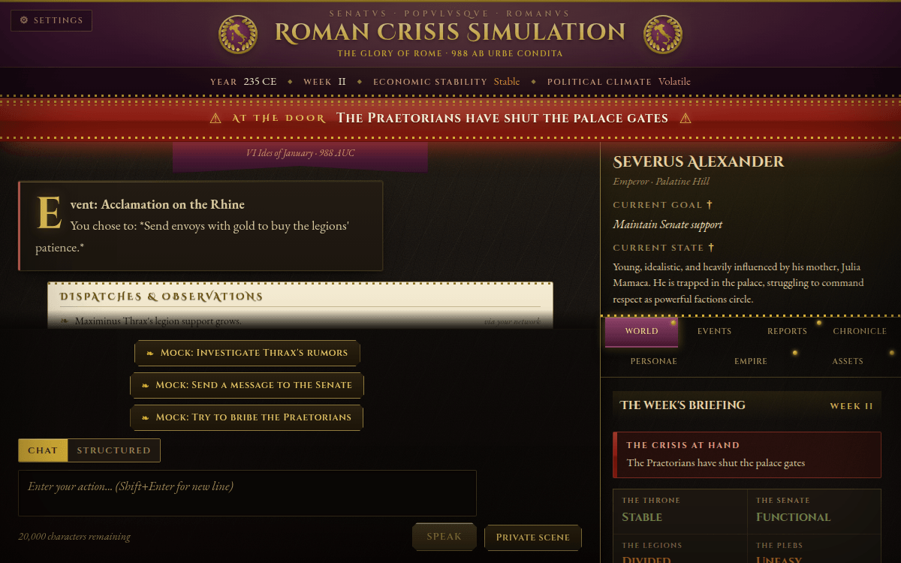

*Above: **The Glory of Rome (235 CE)** in the **NOX Romae** torchlight skin during an active Succession Crisis — showing the streaming Chronicle on the left and the 7-register Intelligence Desk on the right.*

</div>

---

## Why Realmweaver Exists

### The Problem: Spreadsheets vs. Hallucinations

For decades, grand strategy and political RPGs have been trapped between two extremes:

1. **Rigid Deterministic Spreadsheets:** Traditional strategy games reduce human duplicity—betrayal, paranoia, whispered alliances, and off-screen machinations—to static opinion modifiers (`+15 Gift`, `-40 Border Friction`) and brittle dialog trees. True political intrigue has too many abstract, contextual inputs to hand-code deterministically.
2. **Unbounded LLM Roleplay ("Storytime Sandboxes"):** Conversely, raw LLM chat dungeons fail as *games*. Without a deterministic spine, models fold whenever a player types *"I brilliantly convince the Senate to crown me,"* leak omniscient secrets into narration, forget long-term NPC schemes across turns, and hallucinate state changes without consequences.

### The Realmweaver Solution: *"Code Decides Whether, AI Decides How"*

**Realmweaver** is a client-side narrative simulation engine (featured here with its flagship historical scenario, **The Glory of Rome, 235 CE**) that unites **code-enforced simulation law, seeded RNG, and hard information boundaries** with **autonomous multi-agent AI minds and theatrical voice performance**:

| Pillar | How Realmweaver Enforces It | Key Modules & Rulings |
| :--- | :--- | :--- |
| **1. Weave Any Realm from a Meta-Narrative** | Step into the crisis of **Rome, 235 CE** as one of four historical archetypes (*Emperor Severus Alexander*, *General Maximinus Thrax*, *Senator Gaius Pontius Magnus*, or *Spymaster Lycinia Stolo*), weave a custom 5th persona into 235 CE, or **Forge a New Destiny** from *any* free-text Meta-Narrative theme to dynamically generate a complete playable world—regions, factions, interlocking NPC relationships, schemes, secrets, and cast voices. | `ai/core/initiator.ts` · `components/CharacterSelection.tsx` |
| **2. Strict Information Asymmetry in Code** | The engine maintains a GM-private ground-truth state and **Truth Ledger** (`D11`), but filters every atomic `EventDelta` through a code-enforced perception firewall before it ever reaches the narrator or UI. You only know what happened in your region, through your network, or in the public streets. **The system is an honest window (`D26`)—only in-fiction sources can lie.** There are no immersion-breaking `73% Credibility` numbers (`D25`); you weigh corroborating and conflicting accounts yourself. | `perception/visibility.ts` · `ai/core/playerBoundary.ts` · `knowledge/store.ts` (`D5`, `D11`, `D25`, `D26`, `D42`) |
| **3. Autonomous, Bounded NPC Minds** | Each week, the AI Director selects spotlight rivals who execute independent mind calls. Each NPC mind sees **only its own bounded perception** of the world (`npcPerception.ts`)—never your secret ledger or private thoughts—and advances multi-step schemes behind your back even when you take a quiet or observational turn (`D46`). | `ai/core/turn.ts` · `perception/npcPerception.ts` · `ai/core/actorsBoundary.ts` (`D10`, `D30`, `D46`) |
| **4. Deterministic Seeded Resolution & Mortality** | Before the adjudicator or narrator writes a single word, consequential gambits are assessed and rolled in code against a **reign-seeded d20 (`mulberry32`)** (`D51`—retry-proof and 100% replayable). Claimed deaths must pass code-side mortality gates (`mortality.ts`), and targets of assassination can even survive as **presumed dead** (`secret_truth`), returning from the shadows weeks later. | `ai/core/resolution.ts` · `ai/core/mortality.ts` (`D2`–`D4`, `D51`) |
| **5. Embodied Characters: Marks, Ties & Tells** | Characters are not stat blocks. They carry outward scars and inward burdens (**Lasting Marks**, `D48`), plus open and secret allegiances (**Ties**, `D49`—from the Senatorial Party to outlawed cults). During 1-on-1 Private Audiences (`D39`) and weekly turns, hidden **Composure Rolls** (`D50`) decide whether a rival's secret burden holds firm, frays into a subtle physical tell (`<voice catching>`), or breaks into the open. | `ai/core/conditions.ts` · `ai/core/affiliations.ts` · `ai/core/composure.ts` (`D39`, `D48`–`D50`) |
| **6. Theatrical Acted Narration & AI Voice Cast** | An optional two-stage voice pipeline converts committed chronicles into dramatically acted scripts with `<angle-bracket performance cues>`, guarded by `performanceScript.ts` against hallucinated names or mechanics leaks, and performed via `gemini-3.8-flash-tts`. An AI Casting Director assigns unique voices and delivery notes to every known character, and NPCs speak their own lines directly in Private Audiences. | `narration/` · `ai/tools/voiceCasting.ts` · `narration/sceneVoice.ts` |
| **7. The Fates' Ledger (11-Tab GM Console & Eval Suite)** | Press `Ctrl+Shift+G` at any time to open the dark-tablinum **Fates' Ledger**: inspect per-turn Ground Truth vs. Player Belief side-by-side, read private NPC mind reasoning, verify schema-declared attribution redactions, re-run deterministic seed replay checks (*"Strike the mould again"*), inject GM directives, or export a turn corpus for the offline deterministic + 5-axis LLM-Judge evaluation harness. | `components/GameMasterScreen.tsx` · `eval/harness.ts` · `eval/judge.ts` (`D7`, `D18`) |

---

## Visual Tour: Two Imperial Skins, Every Surface Crafted

Realmweaver ships with a custom-engineered Roman design system (`design/`) featuring self-hosted Latin typography (*Cinzel*, *Cinzel Decorative*, and *EB Garamond*), engraved double-rule borders, and two WCAG AA contrast-verified themes switchable at any time via the header's **LVX / NOX** toggle:

- **NOX Romae (Night Skin):** Obsidian marble, torchlight gold (`--gold-500`), imperial crimson, and Tyrian purple accents—designed for atmospheric late-night scheming.
- **LVX (Day Skin):** Warm Carrara stone, aged papyrus, sepia ink, and carnelian wax seals—evoking an illuminated senatorial dossier.

### 1. Choose — or Forge — Your Destiny (`CharacterSelection`)

Start immediately in **235 CE** with one of four asymmetric historical presets, or switch to **Forge a New Destiny** to weave a custom character or an entirely new world from your own Meta-Narrative prompt:

| **NOX Romae** — Full-Width Imperial Selection | **LVX** — Compact Hero & Scenario Forge |
| :---: | :---: |
| 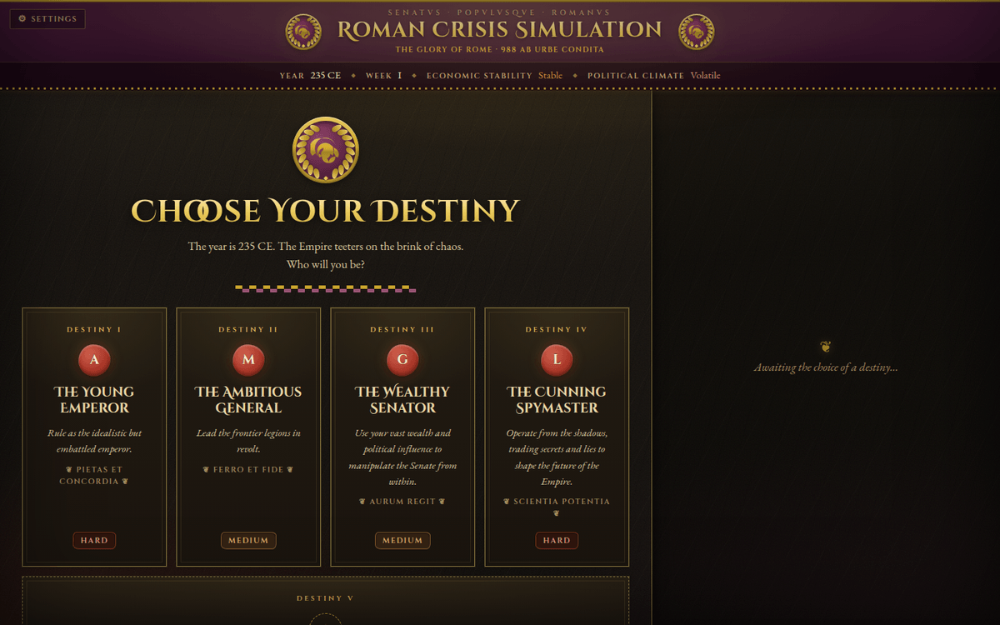 | 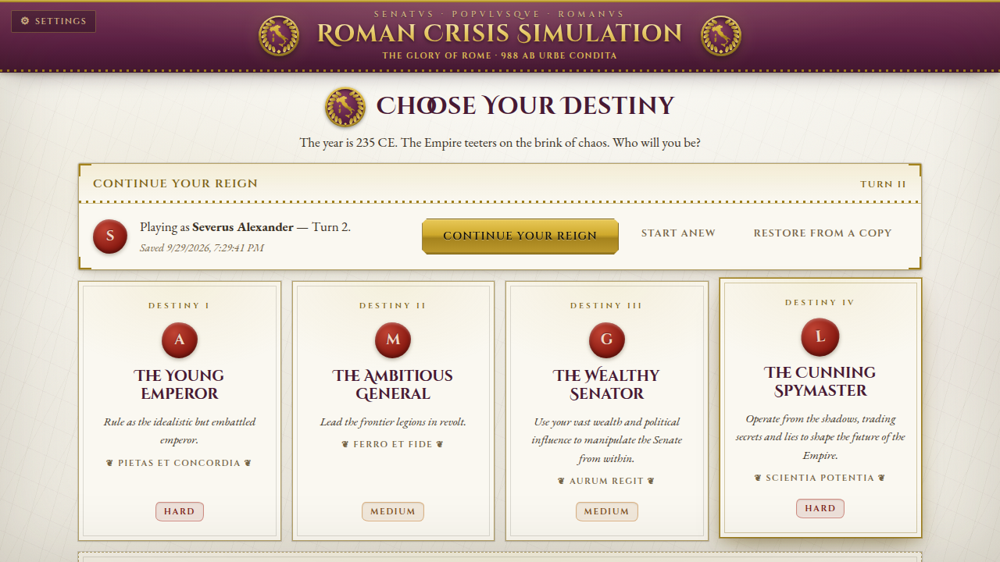 |

---

### 2. The Chronicle & The 7-Register Intelligence Desk (`NOx` vs. `LVX`)

The main workspace pairs the **Chronicle** (left 2/3—streaming narration, inner monologue, week-advance `TurnRibbon` dividers, and perception-filtered **Dispatches Digest**) with the **Intelligence Desk** (right 1/3—your personal dossier header, **Imperial Dispatch** audio reader, and 7 specialized intelligence registers):

| **NOX Romae** — Active Crisis & Intelligence Desk | **LVX** — Carrara Marble & Parchment Desk |
| :---: | :---: |
|  | 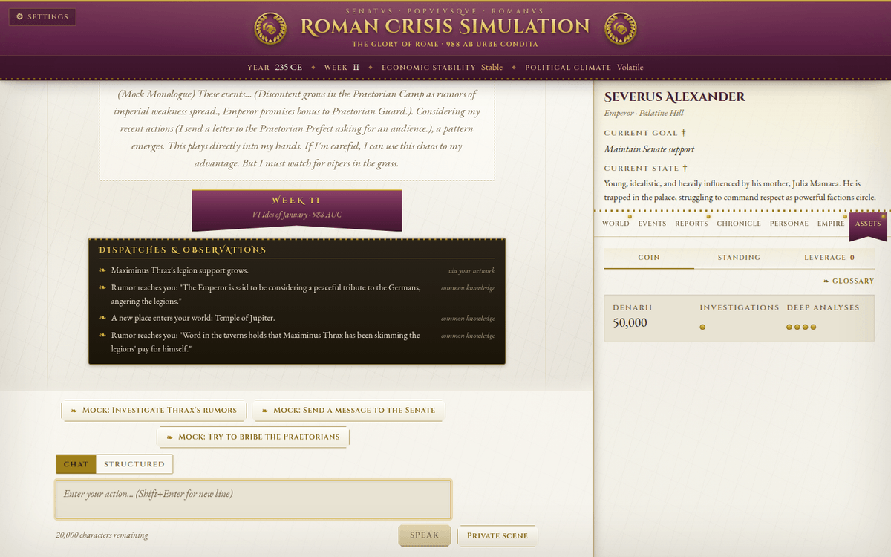 |

---

### 3. Structured Turn Composer, Gold Coin Change Badges & `Ctrl+K` Command Palette

Issue decrees in free prose or open the **Structured Turn Composer** (`playerInput/`) to combine a primary **Order**, **Private Intent**, and **Inquiries**. When a turn commits, only changes you could plausibly perceive increment the **gold coin change-count badges** (`1`–`7`) on the affected intelligence registers. Power users can navigate every register, open a Private Audience, or summon the Fates' Ledger instantly via the **`Ctrl+K` / `⌘K` Command Palette** (or `?`):

| Structured Turn Composer & Folded Registers (`1280×720`) | `Ctrl+K` Command Palette with Unseen Change Counts |
| :---: | :---: |
| 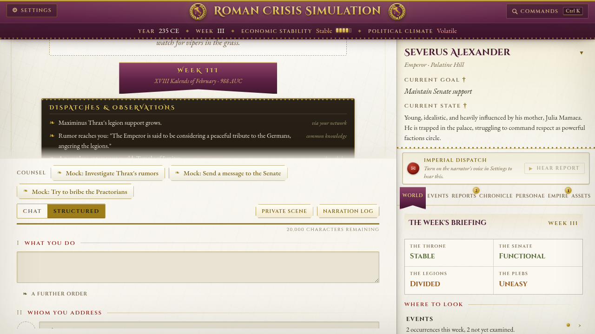 | 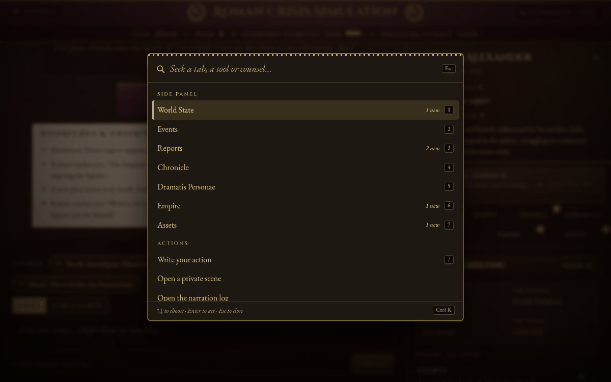 |

---

### 4. Espionage, Persistent Dossiers, Marks, Ties & Sourced Relationships (`DramatisPersonaeTab`)

Forget omniscient "-10 to +10" trust bars. In Realmweaver, **Dramatis Personae** is a true intelligence dossier backed by your persistent belief graph (`knowledge/store.ts`). Inspect an NPC's **Outward Marks** (`D48`), **Open & Secret Ties** (`D49`), **Composure Signs Seen** (`D50`), and **Sourced Relationship Web** (`D13`—every bond tagged with who told you and when, never raw ground truth):

| Persistent Dossiers, Marks, Ties & Keyless Mock Banner | Faction Dossiers & Espionage Briefings in NOX |
| :---: | :---: |
| 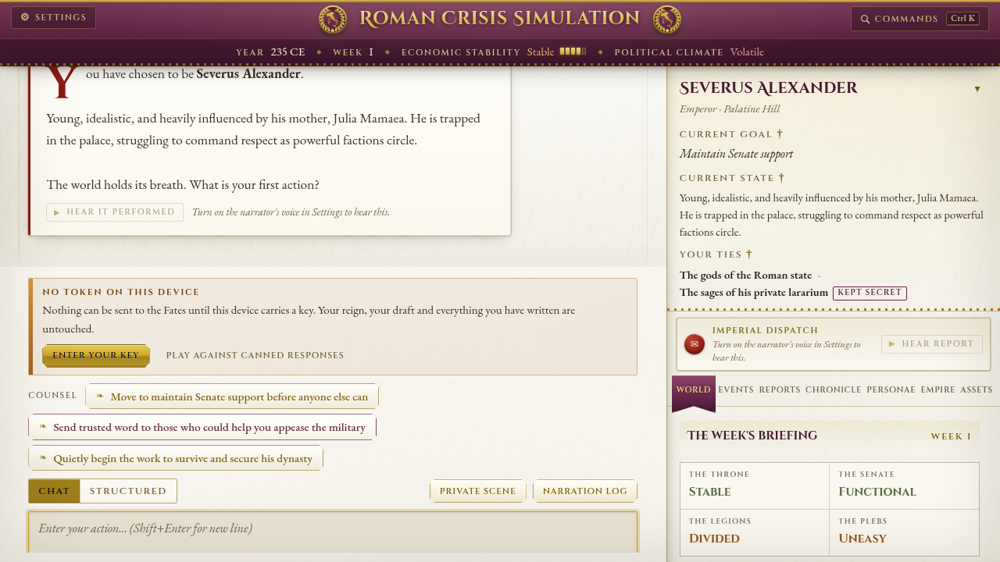 | 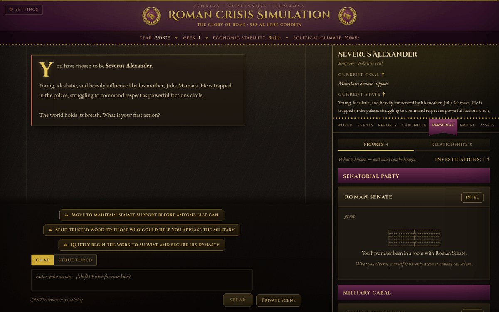 |

---

### 5. AI Voice Casting Director & 1-on-1 Private Audience Scenes (`narration/` & `privateScene/`)

Summon any known figure in your location for a tense, multi-exchange **Private Audience** (`D39`)—speaking plainly, guardedly, or pressing a point while watching for composure tells. Turn on the **Narration Voice** in Settings to let the AI Casting Director assign a unique voice and delivery manner to every character in your campaign:

| AI Voice Cast Register (`Settings → The Cast`) | 1-on-1 Private Scene with Direct Character Voice |
| :---: | :---: |
| 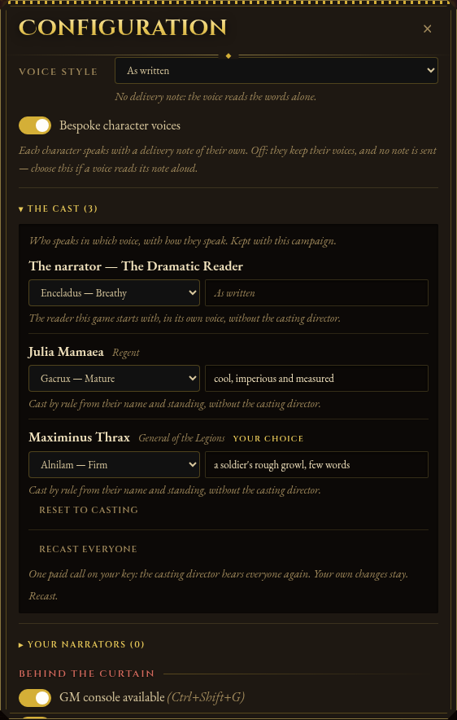 | 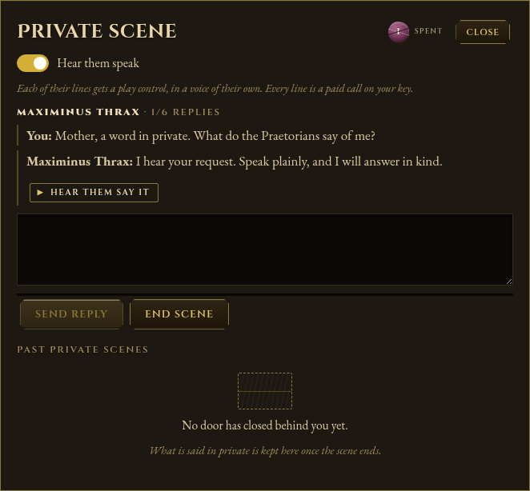 |

---

### 6. Responsive Mobile Design: Swipeable Diptych Leaves

Below `768px`, the desktop split transforms into two horizontally swipeable scroll-snap leaves (**Chronicle ↔ Intelligence Desk**) with a compact 2×2 world-state masthead and touch-friendly register grid:

| Mobile Leaf 1: The Chronicle & Composer (`390×844`) | Mobile Leaf 2: Swipeable 7-Register Intelligence Desk |
| :---: | :---: |
| 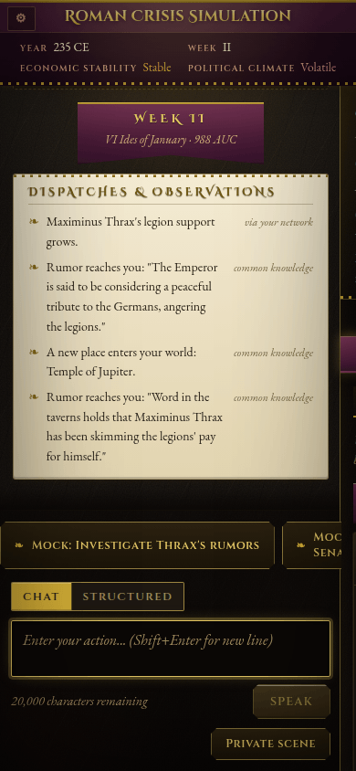 | 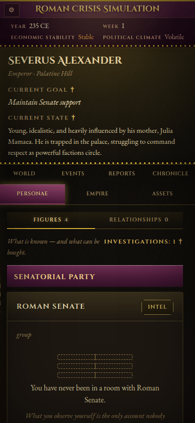 |

---

## Architecture & Turn Pipeline

Every weekly turn in Realmweaver executes a **7-stage transactional pipeline** (`ai/core/turn.ts` + `hooks/useExecuteTurn.ts`) that enforces deterministic resolution and strict perception boundaries at every seam:

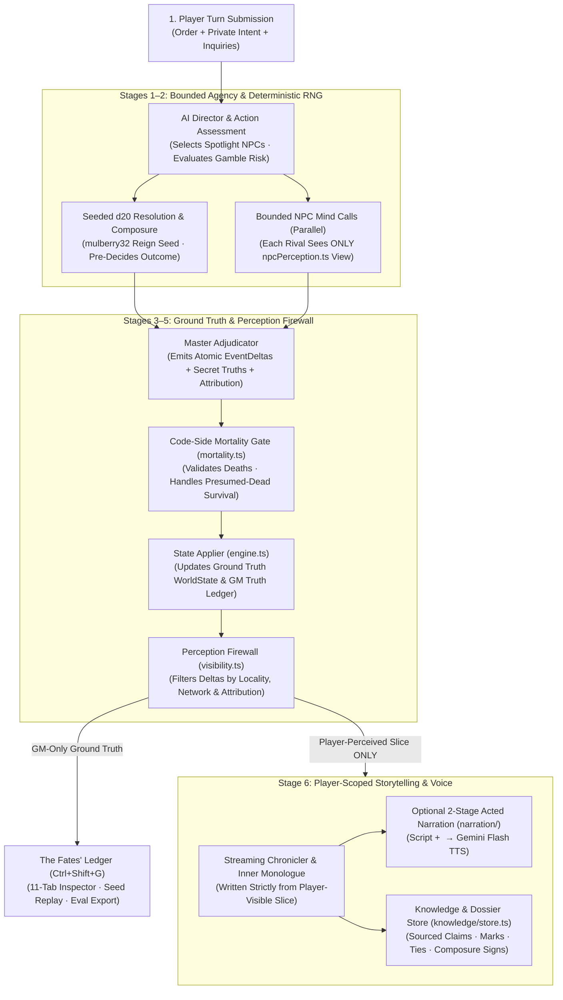

---

## Quick Start: Play in 60 Seconds

> **Prerequisite:** **Node.js `>= 22`** (`node -v`). Realmweaver is a 100% client-side application—there is no backend server or database to configure.

### 1. Install & Launch the Dev Server

From the **repository root** (using the root convenience scripts):

```bash
npm run install:app
npm run dev
```

Or directly inside the application directory (`roman_crisis_simulation/src`):

```bash
cd roman_crisis_simulation/src
npm ci
npm run dev
```

Open the local URL printed by Vite (typically `http://localhost:5173`).

### 2. Two Ways to Play Immediately

#### Option A — Instant Offline Demo (Zero-Config Mock Mode)
Don't have a Gemini API key handy? **You can play immediately with zero setup:**
1. Launch the app and select any character (or forge a custom destiny).
2. On the amber *"No Gemini key is set"* banner at the top of the desk, click **"Play against canned responses"** (or open **⚙ Settings → Workshop** and toggle **Mock Mode**).
3. Experience the full UI—turn progression, intelligence registers, investigations, private scenes, and the `Ctrl+Shift+G` Fates' Ledger—completely offline against deterministic mock fixtures.

#### Option B — Live Multi-Agent Gemini AI (Bring-Your-Own-Key, `D34`)
For the full emergent simulation with live NPC minds, dynamic world generation, and acted TTS narration:
1. Click **⚙ Settings** in the top-right header (or press `Ctrl+K` → *Configuration*).
2. Paste your **Gemini API Key** into the key field and click **Save**.
   - **Privacy Guarantee (`D34`):** Your key is stored *exclusively* in your browser's `localStorage`. It is never bundled into build output, never written into campaign save files, and never included in GM eval-corpus exports.
3. *(Optional for local dev convenience)*: Copy `.env.example` to `.env` and set `GEMINI_API_KEY=your_key_here` (injected only during `npm run dev`, never in `npm run build`).

---

## Verification & Quality Bar

Realmweaver is engineered with strict, defense-in-depth verification across type safety, information-asymmetry boundaries, accessibility, and narrative quality.

Run the full CI verification suite from the repo root (or `roman_crisis_simulation/src`):

```bash
npm run verify
```

`npm run verify` executes all three CI legs in sequence:

| Verification Leg | Command | What It Enforces |
| :--- | :--- | :--- |
| **1. Static Analysis** | `npm run verify:static` | Zero-error TypeScript (`tsc --noEmit`) + zero-warning ESLint (`eslint .`) across all source, test, and eval files. |
| **2. Unit & Boundary Suite** | `npm run verify:unit` | **3,101 Vitest unit tests across 136 test files** pinning the perception firewall (`visibility.ts`), player/actor data boundaries, seeded d20 resolution, composure/mortality gates, knowledge store migrations, voice cue sanitization, and **WCAG AA color contrast** (`tests/colorContrast.test.ts`) for both `LVX` and `NOX` themes. |
| **3. Journeys, Eval & Build** | `npm run verify:integration` | **18 multi-turn full-pipeline campaign journeys across 12 journey files** (`npm run test:journeys`), the **offline deterministic evaluation harness** (`npm run eval:ci` over `eval/fixtures/ci-corpus.json` checking leak rates, schema validity, and agency preservation), and a clean production bundle (`npm run build`). |

---

## Repository Map

| Path | Description |
| :--- | :--- |
| [`roman_crisis_simulation/src/`](roman_crisis_simulation/src/README.md) | **The Application & Engine** — React 19 + TypeScript + Vite SPA. See [`roman_crisis_simulation/src/README.md`](roman_crisis_simulation/src/README.md) for the deep-dive module guide. |
| ├── `ai/core/` | Turn pipeline (`turn.ts`), state applier (`engine.ts`), lasting marks (`conditions.ts`, `D48`), open/secret ties (`affiliations.ts`, `D49`), seeded d20 (`resolution.ts`), mortality (`mortality.ts`), composure (`composure.ts`), grounded truth (`groundTruth.ts`), world generator (`initiator.ts`), and player/NPC boundary guards. |
| ├── `ai/prompts/` & `ai/tools/` | Prompt builders (`ai/prompts/README.md` stage inventory) and specialized tool calls (NPC minds, investigations, private scenes, voice casting, relationship observations). |
| ├── `perception/` & `knowledge/` | Code-enforced information asymmetry: `visibility.ts` (player filter), `npcPerception.ts` (NPC filter), and `knowledge/store.ts` (player belief graph, dossiers, marks, ties, tells). |
| ├── `narration/` | Optional two-stage acted voice pipeline (`gemini-3.8-flash` script prep with `<cues>` → `gemini-3.8-flash-tts`), `performanceScript.ts` guard, AI voice cast, and WAV player. |
| ├── `components/` & `design/` | All UI screens, the 7 intelligence tabs (`components/tabs/`), the 11-tab GM console (`components/gm/`), shared accessible primitives (`components/ui/`), and the `gor-*` LVX/NOX design system. |
| ├── `eval/` | Offline evaluation suite (`eval/README.md`): deterministic invariants (`harness.ts`) + optional 5-axis LLM-as-Judge (`judge.ts`). |
| └── `tests/` | **136 unit test suites (3,101 tests)** + **18 end-to-end multi-turn campaign journeys** (`tests/journeys/`). |
| [`roadmaps/`](roadmaps/ROADMAP_0_MASTER_PLAN.md) | Architectural roadmaps, [`DESIGN_DECISIONS.md`](roadmaps/DESIGN_DECISIONS.md) (binding rulings `D1`–`D51`), [`ROADMAP_UPLEVEL_2026-09.md`](roadmaps/ROADMAP_UPLEVEL_2026-09.md), and [`BACKLOG.md`](roadmaps/BACKLOG.md). |
| [`DesignDocs/`](DesignDocs/UI_SYSTEMS_CURRENT_AND_FUTURE.md) | Comprehensive UI systems inventory ([`UI_SYSTEMS_CURRENT_AND_FUTURE.md`](DesignDocs/UI_SYSTEMS_CURRENT_AND_FUTURE.md)) and visual screen wireframes ([`UI_SCREEN_WIREFRAMES.md`](DesignDocs/UI_SCREEN_WIREFRAMES.md)). |
| [`docs/ui-refresh/`](docs/ui-refresh/) | Visual showcase screenshots capturing NOX Romae, LVX, mobile responsive leaves, voice cast, structured composer, and command palette. |
| [`docs/superpowers/`](docs/superpowers/) | Per-feature engineering specifications and implementation plans across Phases 1–6 and Uplevel Parts 1–10. |
