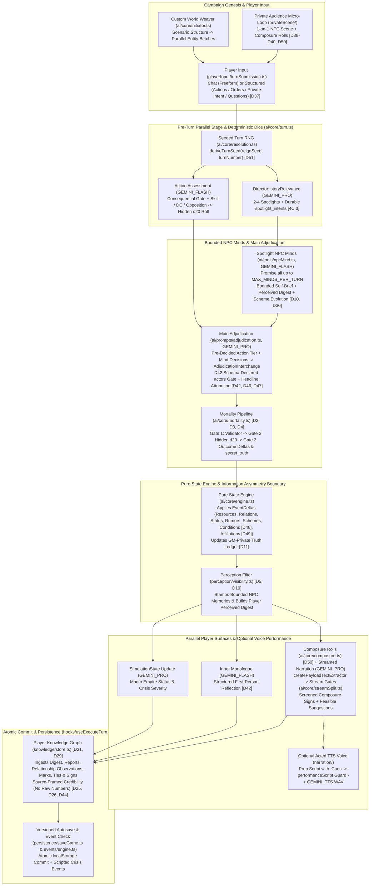

# **Realmweaver — The Glory of Rome (235 CE): Engine & Application Architecture**

> **🏛️ Interactive HTML Architecture Atlas:** Open [**`docs/showcase/index.html`**](../../docs/showcase/index.html) ([`docs/showcase/index.html`](../../docs/showcase/index.html) from the repo root) in any browser for a self-contained, zero-build interactive exploration of the **8-Stage Turn Pipeline**, **21 AI Call Roles**, **4-Column Information Asymmetry & Perception Firewall Simulator**, **Embodied Character & Knowledge Graph Data Model**, and **11-Tab Fates' Ledger Gallery** in live `NOX Romae` and `LVX` themes.

## **Intent of the Game**

**Realmweaver — The Glory of Rome (235 CE)** is an interactive narrative strategy simulation designed to immerse the player in the political turmoil of the Crisis of the Third Century (or any custom world forged via the World Weaver). It creates an emergent, character-driven chronicle where every decision collides with independent, scheming non-player characters (NPCs). The core experience is built around **information asymmetry enforced in code**, **deterministic resolution under the hood ("code decides WHETHER, the model decides HOW")**, and **survival-only stakes** (D1: only player death ends a reign).

Unlike traditional strategy games centered on map painting or spreadsheet micromanagement, this simulation prioritizes political intrigue, leverage, and imperfect intelligence. You see the world solely through your character's eyes, co-located witnesses, and spy network (`perception/visibility.ts`, D5). Rumors may be planted or contradicted, agents may return garbled or false accounts (D47), NPCs bear lasting outward or inward marks (`conditions`, D48) and open or secret allegiances (`affiliations`, D49), and subtle behavioral tells may slip when a character's composure frays or breaks (D50).

---

## **End-to-End Architecture & Turn Data Flow**

---

## **Running the Game — Providing a Gemini API Key**

`DESIGN_DECISIONS.md` D34: bring-your-own-key is the default, preferred way to play. There is no server component and no build-time key injection — the game never bundles a key into `npm run build`'s output.

* **As a player (or the owner, on any device):** run the app (`npm run dev`, or open the built site) and click the **⚙ Settings** affordance in the header to open the configuration menu (D43). Paste your own Gemini API key there and click Save. It is stored in that browser's `localStorage` only — never sent anywhere but Google, never written into a save file, never included in the GM console's eval-corpus export, and never logged. Clicking Clear removes it. No key at all is a valid state too: the game still boots and **Mock Mode** plays entirely offline with no API calls; attempting a *real* turn with no key surfaces an in-world notice pointing back at Settings instead of a raw network error.
* **As the owner, for local dev convenience only:** copy `.env.example` to `.env` and fill in `GEMINI_API_KEY`. `vite.config.ts`'s `define` block injects it, but **only for the dev server** (`npm run dev`) — `npm run build`'s output never contains it, and this convenience is dead code in production (guarded by `import.meta.env.DEV`).
* **As the owner, on Windows, without a plaintext file:** store the key as a **generic credential** in Windows Credential Manager under the target `GloryOfRome:GEMINI_API_KEY` (`cmdkey /generic:GloryOfRome:GEMINI_API_KEY /user:api /pass:<key>`, or the Credential Manager UI). The dev server reads it at startup via `vite.config.ts` and injects it through the same serve-only `define` seam. Priority when several sources exist: the in-app configuration-menu key (`localStorage`) wins at runtime, then a filled-in `.env`, then the credential store. Same D34 boundary — dev server only, never in build output.
* The configuration menu is the single home for every option (D43): lighting (`LVX` / `NOX`), Reading preferences (text size, motion, narration reveal, single-key shortcuts, dossier fold), the narration voice & cast, the D23 Fates pacing posture, reign export/import (D45), and the D32/D33 GM Intervention / GM console availability toggles.

---

## **Codebase Structure**

A React 19 + TypeScript + Vite single-page application with no server: every Gemini call is made from the browser with the player's own key (D34), and all persistence lives in `localStorage`. The load-bearing invariant is **information asymmetry enforced in code**: the adjudicator's output is ground truth, and dedicated projection layers decide what each viewer (the player, each NPC mind, the GM console) is allowed to see.

| Directory | Responsibility |
|---|---|
| **`/ (this folder)`** | Entry points (`index.html`, `index.tsx`), the composition root (`App.tsx`), the shared domain model (`types.ts`), and tooling config (`package.json`, `tsconfig.json`, `eslint.config.js`, `vite.config.ts`, and one `vitest.*.config.ts` per test leg). |
| **`/state`** | The single game-domain reducer (`gameReducer.ts`) and React context (`GameContext.tsx`, D17). Every slice the autosave reads lives here; `App.tsx` is the only consumer of the context and passes plain props down. |
| **`/hooks`** | Stateful orchestration extracted from `App.tsx`: `useExecuteTurn.ts` & `useTurnFlow.ts` (the turn transaction: submit → `runNewTurn` → knowledge/relationship follow-ups → atomic commit or rollback), `useCampaignTransactions.ts`, `useCampaignLifecycle.ts`, `useIntelCommits.ts`, `usePlayerPerception.ts`, `usePrivateSceneController.ts`, `useEventFlow.ts`, `useSettings.ts`, `useGmConsole.ts`, `useWeekBeat.ts`, `useShellEffects.ts`, `useOnboarding.ts`, `useChatFollow.ts`, `useCommandPalette.ts`, `useReadingPrefs.ts`, and the voice hooks (`useNarrationVoice.ts`, `useVoiceCast.ts`, `useNarrationLog.ts`, `usePrivateSceneVoice.ts`, `useImperialDispatch.ts`). |
| **`/app`** | Pure helpers used by the composition root: transaction types (`transactions.ts`), lazy screen loaders (`lazyScreens.tsx`), and the command palette model (`commands.ts`, `domCommands.ts`). |
| **`/ai/core`** | The 8-stage turn pipeline (`turn.ts`), pure state engine (`engine.ts`), lasting marks (`conditions.ts`, D48), open/secret ties (`affiliations.ts`, D49), single Gemini gateway (`geminiService.ts`), deterministic seeded resolution and turn replay (`resolution.ts`, `turnReplay.ts`), two-gate mortality (`mortality.ts`), composure rolls and tell screening (`composure.ts`, D50), grounded intelligence planning (`groundTruth.ts`, D47), structured JSON stream extraction (`streamSplit.ts`), player/actor boundary enforcement (`playerBoundary.ts`, `actorsBoundary.ts`, D42), and schemas (`schemas.ts`, `zodSchemas.ts`). |
| **`/ai/tools`** | Focused model calls outside the main adjudication: `assessment.ts`, `npcMind.ts`, `intelligence.ts` (Director, simulation state, monologue, investigations, occurrence questions, deep analysis), `ambition.ts`, `privateScene.ts`, `relationshipObservations.ts`, `noAttemptResponse.ts`, `characterCreator.ts`, `narrationVoice.ts`, and `voiceCasting.ts`. |
| **`/ai/prompts`** | Every prompt builder, one file per call family, plus shared `fragments.ts` (`asPromptData` D41 boundary). See `ai/prompts/README.md` for the full call inventory. |
| **`/perception`** | Viewer-specific visibility filters: `visibility.ts` decides which ground-truth deltas, marks, ties, and private-scene fields a given viewer can perceive (D5); `npcPerception.ts` projects outward marks and open ties of figures in an NPC's view (D10/D48/D49). |
| **`/knowledge`** | The player's belief graph: the claim & edge store (`store.ts`, D21/D29), commit-time ingestion (`commit.ts`), cited relationship observations (`relationships.ts`), qualitative credibility & corroboration framing that never shows raw numbers (`credibilityFraming.ts`, D25/D26/D44), and dossier refresh pricing (`pricing.ts`, D27). |
| **`/playerInput`** | Canonical `TurnSubmission` wire format, audience projections, and validation (`turnSubmission.ts`, D37) plus composer draft state (`composerState.ts`). |
| **`/playerView`** | Player-facing responses synthesized strictly from existing player knowledge (`noAttemptResponse.ts` for question-only and private-intent turns). |
| **`/privateScene`** | Pure model of one-on-one audiences with an NPC (`model.ts`: access gates, speech acts, D50 composure rolls and stage-direction `delivery`, closure rules, and audience projections). |
| **`/narration`** | Optional acted TTS voice pipeline ("Hear it performed", off by default): narrator profiles (`narrators.ts`, `narrators/`), `<angle-bracket>` script sanitizer (`performanceScript.ts`), campaign voice cast (`voiceCast.ts`), delivery styles (`voiceStyle.ts`), private-scene speech (`sceneVoice.ts`), PCM-to-WAV encoder (`wav.ts`), LRU audio player (`narrationPlayer.ts`), device log (`narrationLog.ts`), and local tuning harness (`tuning/`). See below and `narration/narrators/README.md`. |
| **`/events`** | Evaluation of authored historical/crisis events against `WorldState` and `SimulationState` (`engine.ts`), repeatable cooldowns, ripe historical material selection (D24), and `stabilityVocabulary.ts`. |
| **`/constants`** | Static starting data: the 235 CE base scenario (`baseScenario.ts`, carrying `voice`, `epithet`, `conditions`, and `affiliations`) and authored event definitions (`events.ts`). |
| **`/persistence`** | Browser storage seam: versioned autosave and raw-blob reign export/import (`saveGame.ts`, `saveMigrations.ts`, D45), cross-tab write detection (`crossTab.ts`), device preferences (`apiKey.ts`, `settings.ts`, `uiPrefs.ts`, `readingPrefs.ts`, `onboarding.ts`), and GM eval-corpus export (`evalCorpus.ts`). |
| **`/components`** | React UI: top-level screens (`CharacterSelection.tsx`, `Chat.tsx`, `SidePanel.tsx`, `PrivateSceneModal.tsx`, `EventModal.tsx`, `EpilogueScreen.tsx`, `GameMasterScreen.tsx`, `SettingsMenu.tsx`, `CommandPalette.tsx`), register tabs (`tabs/`), GM console views (`gm/`), and shared primitives (`ui/`, including `FailureNotices.tsx`, D45). |
| **`/design`** | CSS design tokens (`LVX` day / `NOX` night themes, WCAG AA verified) and `gor-*` component styles (`components.css`, responsive down to 480px/375px). |
| **`/diagnostics`** | Developer-mode client-to-Vite-dev-server error relay (`logger.ts` → `POST /__gor_log`), surfacing AI failures, unhandled rejections, and turn rollbacks directly in the terminal during `npm run dev`. |
| **`/eval`** | Offline evaluation harness over exported corpora: deterministic schema, completeness, and roll-replay checks (`harness.ts`) plus an optional 5-axis LLM judge (`judge.ts`). Never imported by app code; see `eval/README.md`. |
| **`/testing`** | Architecture and design documentation for the multi-turn end-to-end journey smoke harness (`SMOKE_HARNESS_DESIGN.md`). |
| **`/tests`** | **3,098+ unit tests** across **136 test files** (`*.test.ts[x]`), shared factories, and **18 end-to-end campaign journeys** across **12 files** in `tests/journeys/*.journey.ts`. |

---

## **Key Files**

* `App.tsx`: the lean composition root (~477 lines) — wires domain hooks, lazy overlays, and screens.
* `types.ts`: the shared domain model (`Entity`, `WorldState`, `Adjudication`, `EventDelta`, `Report`, `TruthLedgerEntry`, `Condition`, `Affiliation`, `ComposureRoll`, `TurnHistoryEntry`, …).
* `ai/core/turn.ts`: `runNewTurn`, the 8-stage per-turn pipeline; see `ai/core/turn_logic.md` for the deep-dive walkthrough.
* `ai/core/engine.ts`: applies `Adjudication` deltas to entities and world state, stamps NPC perception memories, and updates the GM-private truth ledger.
* `ai/core/geminiService.ts`: the single chokepoint for all Gemini calls (structured JSON, streaming JSON, prose, and TTS audio), retries, Zod validation, and raw-call capture.
* `ai/core/initiator.ts`: generates a custom scenario and cast from a player-supplied meta-narrative ("Forge a New Destiny").
* `perception/visibility.ts`: the ground-truth → viewer-visible projection boundary (D5).
* `knowledge/store.ts`: the player's belief graph (claims, time-stamped updates, corroboration/contradiction edges, D21/D29).
* `persistence/saveGame.ts`: versioned autosave, slot health detection, and reign file export/import (D45).
* `components/GameMasterScreen.tsx`: the GM console (`Ctrl+Shift+G`) — raw prompts/responses, ground truth vs. perceived view, truth ledger, seed replay ("Strike the mould again"), and eval-corpus export.

---

## **Verification & CI Checks**

Run from `roman_crisis_simulation/src`. `npm run verify` runs the exact three legs enforced by CI on every push:

* `npm run verify:static` — `typecheck` (`tsc --noEmit`) + `lint` (zero warnings).
* `npm run verify:unit` — the Vitest unit suite (**3,098+ tests across 136 files**).
* `npm run verify:integration` — `test:journeys` (**18 end-to-end journeys across 12 files**), `eval:ci` (offline deterministic eval over `eval/fixtures/ci-corpus.json` with judge forced off), and `build` (production Vite bundle).

`npm run eval` with `GOR_EVAL_CORPUS=/path/to/corpus.json` (and optionally `GEMINI_API_KEY`) runs the evaluation harness against an exported session corpus.

---

## **Game Logic & Core Systems**

### **1. The 8-Stage Turn Pipeline**

Each turn represents one week of in-game time. For the complete stage-by-stage breakdown and Mermaid sequence diagram, **see `ai/core/turn_logic.md`** and `ai/prompts/README.md`. In brief, `runNewTurn` executes:

1. **Director & Action Assessment** [`story_relevance`]: concurrently selects 2–4 spotlight NPCs with durable `spotlight_intents` (`getStoryRelevance`) and assesses whether the player's observable attempt warrants a hidden roll (`getActionAssessment`).
2. **Deterministic Action Roll** (`resolution.ts`): draws the first d20 from the turn's seeded RNG (`deriveTurnSeed(reignSeed, turnNumber)`, D51) and resolves a pre-decided outcome tier (`critical_failure` → `critical_success`).
3. **Bounded Spotlight NPC Minds** [`npc_minds`]: up to `MAX_MINDS_PER_TURN` spotlight NPCs decide their move in parallel (`getNpcMindDecision`), seeing only their own bounded knowledge and evolving their own `active_scheme` (D10/D30).
4. **Main Adjudication & Boundary Gate** [`adjudication`]: the omniscient GM synthesizes all actions into a structured `Adjudication`, gated by D42 schema-declared `actors` and recorded for D47 headline attribution.
5. **Mortality Pipeline** [`mortality`, conditional]: every claimed death is dispositioned by an independent validator call, a hidden d20 roll, and a pre-decided outcome call (`mortality.ts`, D2/D3/D4).
6. **Pure State Application & Perception** (`engine.ts`, `perception/visibility.ts`): applies all atomic deltas, updates the GM Truth Ledger (D11), and stamps bounded NPC memories.
7. **Parallel Player Surfaces** [`simulation_state`, `monologue`, `narration`]: concurrently updates empire-wide `SimulationState`, generates the player's inner monologue, rolls D50 composure for present NPCs (`composure.ts`), and streams structured JSON narration through `createPayloadTextExtractor` and leak-prevention gates (`streamSplit.ts`).
8. **Atomic Commit & Event Check** (`hooks/useExecuteTurn.ts`, `events/engine.ts`): folds perceived changes and relationship observations into the Player Knowledge Graph (`knowledge/store.ts`), commits atomically to `localStorage`, and checks for triggered crisis events.

### **2. Acted Narration & Campaign Voice Cast (`/narration`)**

The optional narration voice ("Hear it performed", off by default until enabled in Settings) turns committed prose into a dramatic audio performance. For full narrator profile rules and tuning instructions, **see `narration/narrators/README.md`**.

* **Two-Step Script & TTS Pipeline (`ai/tools/narrationVoice.ts`)**:
  * **Intermediary Prep Call (`GEMINI_NARRATION_PREP`, `gemini-3.8-flash` at `low` thinking)**: A narrator profile converts one committed GM narration into an **acted script** (≤2 paragraphs) containing spoken words and inline performance cues in `<angle brackets>` (e.g., `<with senatorial disdain>`, `<a wet belch, then a crude laugh>`).
  * **Deterministic Script Guard (`narration/performanceScript.ts`)**: Enforces the D4/D5 player-knowledge boundary before any audio is synthesized. Sentences introducing unmentioned names or numbers are spliced out (`patchedOut`); invalid cues are dropped individually (`droppedCues`); unparseable brackets or mechanics leaks refuse the retelling and fall back to the plain narration opened by `<grave, measured, dramatic storyteller>`.
  * **Word-for-Word TTS Performance (`GEMINI_TTS`, `gemini-3.8-flash-tts`)**: Receives `## Transcript:` followed by the guarded script and nothing else. Cues inside `<angle brackets>` are performed; everything outside them is spoken aloud. `wav.ts` converts raw PCM bytes into a playable WAV managed by an in-memory LRU player (`narrationPlayer.ts`).
* **Narrator Styles & Personas (`narrators.ts`, `narratorChoice.ts`, `customNarrators.ts`)**:
  * **Built-in & Deployed Readers**: Ships with **The Dramatic Reader** (voiced by *Enceladus*, the player's sworn senatorial ally) and **The Acta Diurna** (`narration/narrators/acta-diurna.json`, voiced by *Gacrux*, a composed third-person gazette reader). New tuned profiles can be built via `npm run narrator:tune` (`narration/tuning/`).
  * **"In character…" & Custom Narrators**: Any known living individual can recount the week in the first person from their public standing and cast voice (`narratorChoice.ts`), or the player can author custom narrator briefs passed strictly as JSON-quoted data (`customNarrators.ts`, D41).
* **Campaign Voice Cast (`voiceCast.ts`, `ai/tools/voiceCasting.ts`)**:
  * Every known living individual receives a unique voice (from the 30-voice Gemini catalog in `voiceCatalog.ts`) and a short delivery manner note, assigned once by the casting director (`castVoices`) and incrementally for newcomers (with a deterministic, register-aware fallback in Mock Mode or on network failure).
  * In `narrationPerformance`, named characters in the passage (up to 6) contribute their cast manner notes to a `HOW THOSE IN THE PASSAGE SPEAK` block.
  * In one-on-one audiences (`sceneVoice.ts`), "Hear them speak" voices the NPC's committed line directly in their cast voice with no prep call, prepending the line's validated D50 stage-direction `delivery` as a single `<cue>` when present.
  * Every performance is logged locally on the device (`narrationLog.ts`, capped at 150 entries) so replays never repeat the prep call.

### **3. Dynamic World Generation ("Forge a New Destiny")**

Players can move beyond the default 235 CE scenario by providing a custom **Meta-Narrative** theme and character concept during setup (`ai/core/initiator.ts`). Step 1 (`scenarioStructure`) generates a tailored `WorldState`, regions, and entity stubs; Step 2 (`entityBatch`) populates the full cast in parallel `Promise.all` batches, complete with personalities, starting relationships, schemes, `voice`, `epithet`, `conditions`, and `affiliations`.

### **4. Grounded Intelligence, Schemes & Nuanced Relationships**

* **Mind-Driven Schemes & The Clue Gate (D28 / D30)**: Spotlight NPCs actively evolve their multi-step `active_scheme` (`turn.ts::foldMindSchemeDeltas`). Proximity awareness only alerts the player that "something is afoot"; uncovering a scheme's true nature requires accumulating `SCHEME_CLUES_TO_REVEAL` (3) paid scheme clues (`ai/prompts/intelligence.ts::buildSchemeNaturePrompt`).
* **Grounded Investigations & Occurrence Inquiries (D47)**: Dossier investigations (`beliefs`, `secrets`, `scheme`), Spymaster Deep Analyses, and Events-tab occurrence questions ("Who is behind it?" / "Who gains?") draw on real ground truth (`ai/core/groundTruth.ts`), scoped by a hidden **fidelity** roll (`fragment` / `partial` / `fuller`) and shaped by a hidden **accuracy** roll (`true` / `garbled` / `false`), with code selecting any decoys and recording the true standing in the GM Truth Ledger (D11).
* **Asymmetric Multi-Axis Relationships**: Relationships are directional (`A:B` is A's view of B) across `trust_level`, `respect_level`, `perceived_threat`, `ideological_alignment`, and `dependency_level`. Raw scores are GM-only; the player's Personae dossier renders cited, provenance-backed relationship observations (`knowledge/relationships.ts`, D44).

---

## **Details of the Object Model (`types.ts`, `knowledge/store.ts`, `privateScene/model.ts`)**

* **`Entity`**: Represents any actor in the simulation (`individual`, `group`, or `faction`):
  * `personality` (`ambition`, `paranoia`, `loyalty`, `cunning`, `honor`) & `skills` (`oratory`, `strategy`, `intrigue`): drive deterministic action, investigation, and composure modifiers.
  * `voice` & `epithet` (4C.5): speech-style directive and public byname used by NPC minds, narration voice-cast blocks, and voice casting.
  * `relationships`: directional map of `Relationship` records toward other entities.
  * `resources`: key-value store for `denarii` (with engine-enforced bankruptcy creditor dependency, D6) and hard assets/holdings (removable via `lost_item`, D48).
  * `short_term_goals`, `long_term_ambitions`, `beliefs`, `secrets`, & `active_scheme`: interior motivations and multi-step designs.
  * `conditions` (D48): lasting marks (`Condition`: `id`, `name`, `description`, `outward`, `severity: 'light' | 'serious' | 'grave'`, `since_turn`). Outward marks are visible in the room; an NPC's inward marks are GM-private and weighed by their mind and composure rolls.
  * `affiliations` (D49): factions, causes, cults, and religions (`Affiliation`: `id`, `name`, `kind`, `public`, `faction_id?`). Openly professed ties (`public: true`) are public knowledge; secret ties (`public: false`) stay hidden until witnessed, investigated, avowed, or exposed.
  * `secret_truth` (D3): GM-private record (`{ actually_alive: true, hidden_since_turn, motive }`) attached by `mortality.ts` when an NPC rolls `presumed_dead` on the fate table. Stripped from every player-facing and NPC-facing prompt.
  * `memories`: perception-stamped log of events the entity personally experienced (D10).
* **`WorldState` & `SimulationState`**: `WorldState` tracks `year`, `week`, `economic_stability` (mapped onto 5 canonical grades by `events/stabilityVocabulary.ts`), `political_climate`, and `regions` (`RegionState`). `SimulationState` tracks empire-level statuses (`imperial_status`, `senate_status`, `military_status`, `plebeian_mood`, `major_ongoing_crisis`, `crisis_severity`).
* **`EventDelta`**: The atomic unit of state change (`resource`, `relation`, `region`, `status`, `rumor`, `scheme`, `add_region`, `remove_region`, `faction`, `world`, `condition`, `affiliation`). Carries structured fields (`new_status`, `new_location`, `condition`, `affiliation`, `lost_item`, `topic`, `stance`, and GM-private `is_true`, `origin_id`, `secret_truth`).
* **`Report`**: A player-visible intelligence item (`source`, `about`, `claim`, `credibility`, `topic`, `stance`). Per D25/D26/D44, raw `credibility` floats are never shown to the player; `knowledge/credibilityFraming.ts` translates source provenance and distinct-source `stance` edges into qualitative corroboration verdicts (`"N sources agree"` / `"Accounts conflict"`).
* **`TruthLedgerEntry`** (D11 / D47): GM-private ground-truth record linking each rumor `Report` or investigation/occurrence finding (`reportId`) to its actual `isTrue` disposition, `originId`, and `IntelFindingTruth` (`standing`, `groundTruth`, `distortion`, `planned`, `rolls`).
* **`KnowledgeClaim`** (`knowledge/store.ts`, D21 / D29 / D50): A node in the player's belief graph (`digest`, `report`, `investigation`, `scheme`, or `sign` channel), accreting time-stamped `KnowledgeUpdate`s and typed `KnowledgeEdge`s (`corroborates`, `contradicts`, `derives-from`, `about`), plus D50 composure `"Signs seen"` (`ingestSignsSeen`, storing only figure + sentence, never the hidden mark or tie handle).
* **`PrivateSceneRecord`** (`privateScene/model.ts`, D38–D40 / D50): Complete state of a one-on-one audience with an NPC, holding the player-visible `transcript` (including screened D50 `delivery` stage directions) alongside GM-private `npcPrivate` (`sincerity`, `hiddenIntent`, `plannedFollowThrough`), `composure` rolls (`npc` and `player` with `told`), and screened `signs`.

---

## **Where to Go Next**

* **Binding Architecture & Design Rulings (D1–D51)**: [`../../roadmaps/DESIGN_DECISIONS.md`](../../roadmaps/DESIGN_DECISIONS.md)
* **September–October 2026 Multi-Track Uplevel & Audit Record**: [`../../roadmaps/ROADMAP_UPLEVEL_2026-09.md`](../../roadmaps/ROADMAP_UPLEVEL_2026-09.md)
* **Master Phased Roadmap & Active Backlog**: [`../../roadmaps/ROADMAP_0_MASTER_PLAN.md`](../../roadmaps/ROADMAP_0_MASTER_PLAN.md) · [`../../roadmaps/BACKLOG.md`](../../roadmaps/BACKLOG.md)
* **8-Stage Turn Pipeline Deep Dive**: [`ai/core/turn_logic.md`](ai/core/turn_logic.md)
* **AI Prompt Inventory, Schemas & Guardrails**: [`ai/prompts/README.md`](ai/prompts/README.md)
* **Acted Narration & Deployed Voice Profiles**: [`narration/narrators/README.md`](narration/narrators/README.md)
* **Offline Evaluation Harness & LLM Judge**: [`eval/README.md`](eval/README.md)
* **End-to-End Journey Smoke Harness Design**: [`testing/SMOKE_HARNESS_DESIGN.md`](testing/SMOKE_HARNESS_DESIGN.md)
