# **Turn Structure and Mechanics: A Deep Dive**

The core of **Realmweaver — The Glory of Rome (235 CE)** is its turn-based simulation engine (`ai/core/turn.ts::runNewTurn`), where each turn simulates one tumultuous week in Rome. A turn is not a simple "player move, computer move" sequence. Instead, it is an 8-stage pipeline where the player's action is weighed by deterministic dice, spotlight NPCs deliberate from their own bounded perceptions, an omniscient AI Game Master adjudicates the collision of wills, code-side gates enforce mortality and information asymmetry, and the player's belief graph commits atomically.

For the prompt-by-prompt inventory (builders, Zod/Gemini schemas, and rules), see `ai/prompts/README.md`.

---

## **End-to-End Turn Pipeline (`runNewTurn` + `useExecuteTurn`)**

```mermaid
flowchart TD
    Input["1. Player Submission (Chat or Structured)<br/>projectSubmission() + deriveTurnSeed(reignSeed, turnNumber) [D37, D51]"]
    
    subgraph Stage0 ["2. Pre-Turn Parallel Stage [TurnStage: story_relevance]"]
        Director["Director: getStoryRelevance (GEMINI_PRO)<br/>2-4 spotlights + durable spotlight_intents [4C.3]"]
        Assess["Action Assessment: getActionAssessment (GEMINI_FLASH)<br/>is_consequential, skill, difficulty (5-25), opposition"]
    end

    Roll["3. Deterministic Action Roll (resolution.ts)<br/>1st draw from turnRng: rollD20 + skill + personality + opposition vs clamped DC"]
    
    Minds["4. Bounded Spotlight NPC Minds [TurnStage: npc_minds]<br/>Promise.all up to MAX_MINDS_PER_TURN (GEMINI_FLASH)<br/>Sees ONLY NPC's own self-brief, perceived digest, memories & public world [D10, D30]"]
    
    Adjudicate["5. Main Adjudication [TurnStage: adjudication]<br/>buildAdjudicationPrompt -> generateStructured (GEMINI_PRO)<br/>Pre-decided action tier + mind decisions -> AdjudicationInterchange (with D42 actors)<br/>enforceNoAttemptBoundary -> attributeHeadlines -> stripActors -> foldMindSchemeDeltas"]
    
    Mortality["6. Mortality Pipeline [TurnStage: mortality, conditional]<br/>processMortality (mortality.ts) [D2, D3, D4]<br/>Gate 1: mortalityValidation (GEMINI_PRO) -> Gate 2: hidden d20 roll -> Gate 3: mortalityOutcome (GEMINI_PRO)"]
    
    Apply["7. Pure Engine Application & Perception Stamp (engine.ts)<br/>applyAdjudication: applies deltas (resources, relations, status, rumors, schemes, conditions [D48], affiliations [D49])<br/>Updates GM Truth Ledger [D11] & stamps bounded NPC memories [D5, D10]"]
    
    subgraph Stage5 ["8. Player Surfaces Stage (Parallel Promise.all)"]
        SimState["getUpdatedSimulationState (GEMINI_PRO)<br/>[TurnStage: simulation_state]"]
        Monologue["getPlayerMonologue (GEMINI_FLASH)<br/>[TurnStage: monologue]"]
        Narration["Composure Rolls (composure.ts) [D50] -> Streamed Narration (GEMINI_PRO)<br/>[TurnStage: narration] generateStructuredStream + createPayloadTextExtractor<br/>narrationStreamGate -> playerVisibleStreamGate -> screenNarrationSigns"]
    end

    Commit["9. Atomic Commit & Post-Turn Hooks (useExecuteTurn.ts & App.tsx)<br/>noAttemptEvidenceSelection (if question-only) + getRelationshipObservations (GEMINI_FLASH)<br/>computeTurnKnowledge (knowledge/store.ts) [D21, D29] + saveGame (localStorage) -> checkForTriggeredEvent (events/engine.ts)"]

    Input --> Stage0
    Director --> Minds
    Assess --> Roll
    Roll --> Adjudicate
    Minds --> Adjudicate
    Adjudicate --> Mortality
    Mortality --> Apply
    Apply --> Stage5
    Stage5 --> Commit
```

---

## **Step-by-Step Walkthrough**

### **1. The Player's Submission & Seed Derivation (`projectSubmission` & D51)**

It all begins when you submit your week's turn from the tablet composer — either in **Chat** mode (freeform prose) or **Structured** mode (explicit observable actions, addressed messages/orders to known recipients, private intent, and questions/context).

* **Mechanics**: `hooks/useExecuteTurn.ts` normalizes your input into a versioned `TurnSubmission` (`playerInput/turnSubmission.ts`, D37) and projects it into audience-specific views (`projectSubmission` in `ai/core/turn.ts`) so each downstream stage sees only what it is allowed to see (for example, a question-only or private-intent-only turn hands `observableAttempt: null` to the adjudicator so it can never fabricate an avatar action). At the same time, the turn's deterministic random generator (`turnRng`) is initialized from `deriveTurnSeed(reignSeed, turnNumber)` (`ai/core/resolution.ts`, D51). Every hidden d20 rolled during the turn — action resolution, mortality saves, and composure checks — draws from this single seeded generator in a fixed order.
* **Player Implication**: Specificity matters, and the distinction between *observable actions*, *private intent*, and *questions* is enforced in code. If you only ask a question or harbor a private thought, the world still advances around you (D46), but the Game Master is mechanically barred from inventing public conduct on your behalf. And because your turn's dice are fixed by `reignSeed` and the turn number (D51), a network drop or page reload never rerolls your luck — retrying a turn replays the exact same dice.

---

### **2. Pre-Turn Parallel Stage: The Director & Action Assessment (`story_relevance`)**

Before simulating the week, `runDirectorStage` launches two independent pre-turn calls concurrently via `Promise.all` under the `story_relevance` stage notification, costing zero extra wall-clock time over a single call.

* **Mechanics**:
  1. **The Director (`getStoryRelevance`, `GEMINI_PRO`)**: Receives last turn's public headlines, the current `WorldState`, the living NPC roster (with each character's `active_scheme` and recent perception-filtered `memories`), and the previous turn's committed `npcIntents`. It picks 2–4 **spotlight entities** to drive the drama this week, emits `spotlight_intents` (`{ entity_id, intent, continuity: 'continue' | 'pivot' | 'new' }`, filtered and capped by `selectDurableIntents`), and may suggest world evolution (`add_entities`, `remove_entities`, `add_locations`).
  2. **Action Assessment (`getActionAssessment`, `GEMINI_FLASH`)**: Runs concurrently whenever your submission contains an observable attempt (skipped for question-only or private-only turns). It classifies whether your attempt is consequential (`is_consequential`), its `action_category`, the relevant skill (`'oratory' | 'strategy' | 'intrigue' | null`), a `difficulty` (clamped in code to 5–25), and an `opposing_entity_id`.
* **Player Implication**: Major NPCs do not wait passively for you to act; the Director carries their agendas across turns. Meanwhile, the assessor determines whether your move is routine conversation or a high-stakes gamble against a rival's strengths.

---

### **3. Deterministic Action Resolution (`resolvePlayerAction`)**

**Code decides WHETHER you succeed; the model only decides HOW it unfolds.**

* **Mechanics**: If `actionAssessment.is_consequential` is true, `resolvePlayerAction` draws the **first** hidden `rollD20(ctx.turnRng)` of the turn and passes it to `resolveAction` (`ai/core/resolution.ts`). Code computes:
  $$\text{total} = \text{d20} + \text{skill} + \text{personalityModifier} + \text{oppositionModifier}$$
  where `oppositionModifier` reads the opposing entity's directional relationship toward you (`perceived_threat` raises their guard; `trust_level` eases it). Comparing `total` against the clamped `difficulty` yields one of five coarse outcome tiers: `critical_failure`, `failure`, `partial_success`, `success`, or `critical_success`. The tier is injected into the adjudication prompt's `PLAYER ACTION OUTCOME` block and recorded on `TurnHistoryEntry.resolutionTrace` (and as a `[Resolution]` `gm_private` note) for the GM console only (D4).
* **Player Implication**: Your character's skills (`oratory`, `strategy`, `intrigue`), personality traits, and the relationships you've cultivated have real teeth. Courting a paranoid senator who views you as a threat is mechanically harder than persuading a trusted ally, even though raw dice numbers never clutter your prose.

---

### **4. Bounded Spotlight NPC Minds (`npc_minds`, D10 / D22 / D30)**

Before the omniscient Game Master adjudicates the week, each living spotlight NPC gets to think for themselves in character.

* **Mechanics**: `runNpcMindsStage` selects up to `MAX_MINDS_PER_TURN` living spotlight NPCs (`selectMindEntities`) and calls `getNpcMindDecision` (`GEMINI_FLASH`) for all of them in a single `Promise.all`.
  * **Strict Information Asymmetry (`buildMindSelfBrief`)**: Each mind prompt receives **only** what that NPC could plausibly know — their own personality, skills, beliefs, secrets, `voice`/`epithet`, `conditions` (D48), and `affiliations` (D49); their own `active_scheme` and Director intent; their own `memories` and private-scene memories; their own viewer-filtered digest of last week's events (`buildPerceivedDigest` from *their* vantage); the outward marks and open ties of figures in their view (`figuresInViewOf`); and public headlines. Another character's secrets, schemes, inward marks, or `secret_truth` never enter a mind prompt.
  * **Mind-Owned Scheme Evolution (D30)**: Each mind returns `chosen_action`, `method`, `private_reasoning`, and an optional `scheme_adjustment`. After adjudication, `foldMindSchemeDeltas` converts any `scheme_adjustment` into a committed `'scheme'` delta (`evolveSchemeFromAdjustment`), superseding any competing adjudicator `'scheme'` delta for that same character. If an individual mind call fails, it degrades softly with a `[Mind]` `gm_private` note and falls back to the Director's intent.
* **Player Implication**: Rivals can be fooled, act on incomplete intelligence, or pivot their long-term schemes behind closed doors based on what they personally witnessed or heard in a private audience with you.

---

### **5. Main Adjudication & The No-Attempt Boundary (`adjudication`, D42 / D46)**

The omniscient AI Game Master now synthesizes the entire week into a single structured `Adjudication`.

* **Mechanics**: `runAdjudicationStage` builds the master prompt (`buildAdjudicationPrompt`), weaving together the `WorldState`, `SimulationState`, `Meta-Narrative`, pacing posture (D23) and ripe historical event material (D24), your submission and pre-decided `playerActionOutcome`, the spotlight `npcIntents` and `npcMindDecisions` (`chosen_action` + `method`), any closed private audience (`privateSceneAdjudicatorProjection`), and the truth behind any filed blackmail (`deriveLeverageTruth`, D47). It calls `generateStructured` on `GEMINI_PRO` (`thinkingBudget: 1024`, `temperature: 0.8`), validated against `AdjudicationSchema` / `zAdjudication`.
  * **Schema-Declared Attribution & Boundary Gate (D42)**: Every prose field in the raw `AdjudicationInterchange` (`headlines`, delta `reason`, `entityActions.notes`) carries an `actors: string[]` declaration naming whose conduct it narrates. `enforceNoAttemptBoundary` checks structural invariants (`assertNoInventedPlayerAction` — failing closed on illegal player-owned deltas on a no-attempt turn while permitting world-originated changes on the player per D46) and redacts any invented player prose via declaration + flat tripwire (`redactInventedPlayerProse`).
  * **Headline Attribution Record (D42 / D47)**: Before `stripActorsFromAdjudication` removes the interchange-only `actors` arrays, `declaredHeadlines` captures which entities were declared behind each post-redaction headline (`TurnHistoryEntry.headlineActors`), grounding later "Who is behind it?" and "Who gains?" inquiries on the Events tab.
* **Player Implication**: The Adjudication is the mechanical "source code" of the week — atomic `EventDelta`s, NPC `entityActions`, public `headlines`, and `gm_private` notes — ensuring that every narrative beat is backed by auditable state changes.

---

### **6. The Mortality Pipeline (`mortality`, D2 / D3 / D4)**

**The model never decides death.** Every death in `adjudication.deltas` is treated as a *claim* (`new_status: 'dead'`) that must pass code-side gates in `ai/core/mortality.ts::processMortality` before state is applied.

* **Mechanics**: When `detectDeathClaims` finds one or more death deltas, `runMortalityStage` fires `onStage('mortality')` and processes each claim:
  1. **Gate 1 — Independent Validation (`mortalityValidation`, `GEMINI_PRO`)**: A dedicated validator checks whether the claimed death was earned by prior setup, vulnerability, and context (`valid: boolean`). Vetoed claims are stripped (preserving prior status) and logged in `mortalityTrace` without touching the dice.
  2. **Gate 2 — Hidden Fate Roll (`rollD20(ctx.turnRng)`)**: Validated claims draw the next d20 from `turnRng`.
     * **Player Death Save (`resolvePlayerDeathSave`, D2)**: `1–5` `dies` (game over), `6–10` `survive_with_loss` (validated loss deltas: removed hard asset and/or new condition per D48), `11–17` `survive`, `18–20` `survive_with_boon`.
     * **NPC Fate Table (`resolveNpcFate`, D3)**: `1–12` `confirmed_dead`, `13–15` `gravely_wounded`, `16–18` `presumed_dead` (public `status: 'dead'`, but `secret_truth: { actually_alive: true, hidden_since_turn, motive }` attached in code), `19–20` `escapes_openly`.
  3. **Gate 3 — Pre-Decided Outcome Dressing (`mortalityOutcome`, `GEMINI_PRO`)**: For bands that require consequence deltas or a survival directive (`survive_with_loss`, `survive_with_boon`, `gravely_wounded`, `presumed_dead`, `escapes_openly`), the model authors bounded deltas and a one-line narration directive for the already-settled band.
* **Player Implication**: Neither you nor major NPCs can be killed off by an arbitrary AI whim. If you survive an assassination attempt with a loss, you bear a real scar or lost holding (D48); if a rival rolls *presumed dead*, the whole Empire mourns them while they plot their return in secret.

---

### **7. Pure State Application, Truth Ledger & Perception (`applyTurnState`, D5 / D11 / D48 / D49)**

With mortality settled, the pure engine applies the week's deltas to the world.

* **Mechanics**: `applyAdjudication` (`ai/core/engine.ts`) iterates through `transformedAdjudication.deltas` and produces updated `entities`, `worldState`, `reports`, and `truthLedger`:
  * Updates `resource` (including `lost_item` hard-asset removal, D48, and bankruptcy creditor dependency, D6), directional `relation` (`A:B:attribute` modifies only A's view of B), `status` (`new_status` / `new_location`), `region`, `faction`, `world`, `scheme`, `condition` (`add`/`deepen`/`ease`/`heal`, outward vs. inward, D48), and `affiliation` (`join`/`leave`/`go_public`/`expose`, open vs. secret, D49).
  * Converts `rumor` deltas into player-visible `Report`s (carrying `source`, `credibility`, `topic`, and `stance`, D29) while writing the ground-truth `is_true` and `origin_id` disposition into the GM-private `TruthLedgerEntry[]` (D11).
  * Stamps perception-filtered memories (`perception/visibility.ts::buildPerceivedDigest`) onto a bounded set of perceiving NPCs (spotlight cast first, D10), recording `perceivingNpcIds` on the history entry.
* **Player Implication**: Every change is now locked into the simulation's ground truth — yet you and each NPC will only learn the slice of those changes your own eyes and spy networks could reach.

---

### **8. Parallel Player Surfaces: Simulation State, Monologue, Composure & Streamed Narration (`runPlayerSurfacesStage`, D42 / D50)**

Once `applyTurnState` completes, `runPlayerSurfacesStage` launches three calls **concurrently via `Promise.all`**:

* **Mechanics**:
  1. **Empire Simulation State (`getUpdatedSimulationState`, `GEMINI_PRO`, `simulation_state`)**: Updates macro trackers (`imperial_status`, `senate_status`, `military_status`, `plebeian_mood`, `major_ongoing_crisis`, `crisis_severity`), gated for D42 `actors` before stripping.
  2. **Player Inner Monologue (`getPlayerMonologue`, `GEMINI_FLASH`, `monologue`)**: Generates a brief first-person reflection from your updated profile, your own marks and ties, this week's public headlines (plus open ties of figures named in them, D49), and your recent intents (`zPlayerMonologuePayload`).
  3. **Composure Rolls & Streamed Narration (`GEMINI_PRO`, `narration`)**:
     * **Perception Filter (D5)**: `buildPlayerPerceivedDigest` filters the turn's deltas down to `{ text, source }` items you could actually perceive (`self`, `witnessed`, `network`, `public`). Raw deltas, `gm_private`, `secret_truth`, and NPC inward marks never enter the narration prompt.
     * **Composure Rolls (`ai/core/composure.ts`, D50)**: Living individuals standing in the same location who interacted with you this turn (`figuresPresentWith`) roll one hidden d20 from `turnRng` (immediately after mortality rolls) for each of their inward marks and secret ties (`holds` / `frays` / `breaks`). Only subjects that frayed or broke are handed to the narrator under opaque handles (`buildComposureBlock`).
     * **Structured JSON Streaming (`streamSplit.ts`, D42)**: Narration runs as a single `generateStructuredStream` call (`NarrationPayloadSchema` / `zNarrationPayload`: `{ text, actors, signs? }`). As raw JSON chunks arrive, `createPayloadTextExtractor` incrementally decodes the `"text"` prefix in sub-millisecond time and pipes it through `createNarrationStreamGate` (hiding trailing `SUGGESTION:` lines) and `createPlayerVisibleStreamGate` (halting on any mechanics leak) straight to `onNarrationChunk`.
     * **Post-Join Screening**: When `Promise.all` settles, prose redaction gates run, `splitNarrationSuggestions` extracts the 3 suggested actions (filtered by `filterFeasibleSuggestedActions`), and `screenNarrationSigns` validates any composure `signs` against `buildTellScreen` (dropping all signs if a boundary gate rewrote the narration prose, `narrationSignsToKeep`).
* **Player Implication**: You watch the chronicle stream onto the tablet in real time, grounded strictly in what your character perceived, complete with subtle behavioral tells ("Signs seen") when a present NPC's composure frays or breaks.

---

### **9. Atomic Commit, Knowledge Graph & Event Check (`useExecuteTurn.ts` & `events/engine.ts`)**

After `runNewTurn` returns `RunNewTurnResult`, `hooks/useExecuteTurn.ts` finishes the transaction before anything is shown as final.

* **Mechanics**:
  * For question-only turns, `buildNoAttemptPlayerResponse` (`ai/tools/noAttemptResponse.ts`, `GEMINI_FLASH`) selects existing evidence IDs from your knowledge store to answer your question without inventing facts.
  * `getRelationshipObservations` (`ai/tools/relationshipObservations.ts`, `GEMINI_FLASH`) selects cited, player-safe relationship observations from this week's perceived evidence (skipped gracefully if offline).
  * `computeTurnKnowledge` (`knowledge/commit.ts`) ingests the perceived digest, reports, relationship observations, outward marks/ties, and screened composure signs into the **Player Knowledge Graph** (`knowledge/store.ts`, D21/D29).
  * `useCampaignTransactions` writes the updated state and `reignSeed` to `localStorage` (`persistence/saveGame.ts`) and dispatches `TURN_COMMITTED` to `state/gameReducer.ts` atomically — or rolls back cleanly on failure, keeping your draft in the composer (D45).
  * Every 3rd committed turn, `getAmbitionInference` (`ai/tools/ambition.ts`, `GEMINI_FLASH`) fires asynchronously in the background for the GM console (D8).
  * Finally, `checkForTriggeredEvent` (`events/engine.ts`) evaluates whether the new `WorldState` / `SimulationState` triggers an authored `GameEvent` (respecting `stabilityVocabulary.ts` grades and repeatable cooldowns).
* **Player Implication**: Your Personae dossiers, Rumor Feed, and Chronicle update in lockstep with your autosave, and crossing a political or economic threshold can immediately confront you with a fateful event modal.

---

## **Summary of Gemini AI Calls Per Turn**

All calls route through `ai/core/geminiService.ts` (`GEMINI_PRO` and `GEMINI_FLASH` both resolve to `gemini-3.8-flash`, with automatic GA fallback `gemini-pro-latest` for pro calls). `isMockMode` bypasses network calls via `mockRunNewTurn`.

| Order | Call Name | Model Tier | Execution | Purpose |
|---|---|---|---|---|
| **1a** | `storyRelevance` | `GEMINI_PRO` | Parallel (`Promise.all` with 1b) | Director: selects 2–4 spotlight NPCs, durable `spotlight_intents` (`continue`/`pivot`/`new`), and world-evolution suggestions. |
| **1b** | `assessment` | `GEMINI_FLASH` | Parallel (`Promise.all` with 1a; skipped if no observable attempt) | Classifies whether the player's observable attempt is consequential, its skill, difficulty (5–25), and opposing entity. |
| **2** | `npcMind:<id>` | `GEMINI_FLASH` | Parallel (`Promise.all`, up to `MAX_MINDS_PER_TURN`; conditional) | In-character decision (`chosen_action`, `method`, `private_reasoning`, `scheme_adjustment`) from that NPC's bounded knowledge only (D10/D30). |
| **3** | `adjudication` | `GEMINI_PRO` (`thinkingBudget: 1024`) | Sequential | Simulates the week's collision of actions using the pre-decided action roll tier and NPC mind decisions; emits `AdjudicationInterchange` with D42 `actors`. |
| **4a** | `mortalityValidation` | `GEMINI_PRO` | Sequential per death claim (conditional) | Gate 1 of `processMortality`: dispositions whether a claimed death was earned (`valid: boolean`) before any mortality die is rolled (D2/D3). |
| **4b** | `mortalityOutcome` | `GEMINI_PRO` | Sequential per validated claim needing content (conditional) | Gate 3 of `processMortality`: authors bounded deltas and a survival/fate directive for the code-rolled mortality band. |
| **5a** | `updatedSimulationState` | `GEMINI_PRO` | Parallel (`Promise.all` with 5b & 5c) | Updates empire-level macro statuses (`imperial_status`, `senate_status`, `military_status`, `plebeian_mood`, `major_ongoing_crisis`). |
| **5b** | `playerMonologue` | `GEMINI_FLASH` | Parallel (`Promise.all` with 5a & 5c; skipped on no-attempt) | Generates the player's first-person inner thought (`zPlayerMonologuePayload`). |
| **5c** | `narration` | `GEMINI_PRO` (`thinkingBudget: 512`, streamed) | Parallel (`Promise.all` with 5a & 5b; skipped on no-attempt without player mortality) | Streams the player-perceived chronicle, 3 `SUGGESTION:` actions, D42 `actors`, and optional D50 composure `signs` (`zNarrationPayload`). |
| **6a** | `noAttemptEvidenceSelection` | `GEMINI_FLASH` | Post-`runNewTurn` in `useExecuteTurn` (question-only turns) | Selects existing knowledge-store evidence IDs to answer a player's question without inventing new facts. |
| **6b** | `relationshipObservations` | `GEMINI_FLASH` | Post-`runNewTurn` in `useExecuteTurn` (before commit) | Extracts cited, provenance-backed relationship observations from player-safe turn evidence (D29/D44). |
| **7** | `ambitionInference` | `GEMINI_FLASH` | Fire-and-forget after every 3rd committed turn | Infers the player's apparent ambition for the GM console only (D8). |
| **Opt.** | `narrationPerformance` → `narrationVoice` | `GEMINI_NARRATION_PREP` → `GEMINI_TTS` | On-demand or `auto` after commit | Converts the committed narration into an `<angle-bracket>` acted script and performs it as WAV audio (`narration/`). |
